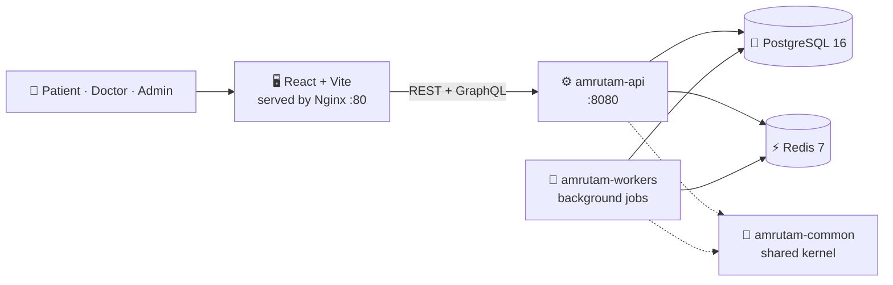

<div align="center">

# 🌿 Amrutam

**A Docker-first telemedicine platform for patient bookings, doctor availability, consultation flows and admin analytics.**


<a href="#-quick-start">Quick start</a> ·
<a href="#-architecture-at-a-glance">Architecture</a> ·
<a href="#-repository-structure">Structure</a> ·
<a href="#-documentation">Documentation</a> ·
<a href="docs/CONTRIBUTING.md">Contributing</a>

</div>

---

## 🎯 Overview

The repository combines a **Java 21 + Spring Boot** backend, **PostgreSQL + Redis** services and a **React + Vite** frontend, all started together with Docker Compose.

| | Capability |
| --- | --- |
| 🧑 | **Patient bookings:** search doctors and book consultations |
| 🩺 | **Doctor availability:** doctors publish and manage time slots |
| 📅 | **Consultation flows:** booking, payment, completion and prescriptions |
| 📊 | **Admin analytics:** daily consultations, revenue and system health |

## 🧭 Architecture at a glance



Deeper diagrams (booking saga, ER model, request flow) are in [docs/Architecture-overview.md](docs/Architecture-overview.md) and [docs/ARCHITECTURE.md](docs/ARCHITECTURE.md).

## 🚀 Quick start

### Prerequisites

| Required | Optional |
| --- | --- |
| Docker Desktop, or Docker Engine with Compose enabled | Java 21, Maven and Node, only if you want to run pieces outside Docker |

### Start the full stack

From the repository root:

| Platform | Command |
| --- | --- |
| macOS / Linux / Git Bash | `./start.sh` |
| Windows PowerShell | `./start.ps1` |
| Docker Compose directly | `docker compose up --build -d` |

```bash
./start.sh
```

```powershell
./start.ps1
```

```bash
docker compose up --build -d
```

### Local runtime URLs

| What | URL |
| --- | --- |
| 🖥️ Frontend | http://localhost |
| ⚙️ API base | http://localhost:8080 |
| 🩻 Health check | http://localhost:8080/actuator/health |
| 📘 Swagger UI | http://localhost:8080/swagger-ui.html |

```bash
curl http://localhost:8080/actuator/health
# expect: {"status":"UP"} (the response also lists db and redis components)
```

> [!TIP]
> The health endpoint is the fastest verification point once the stack is up.

## 🧪 Run the tests

| Layer | Command | Folder |
| --- | --- | --- |
| Backend (Maven) | `mvn test` | `backend/` |
| Frontend (Vitest) | `npm install` then `npm run test:run` | `frontend/` |

Verified results, the load test and the Postman evidence are in [docs/testing.md](docs/testing.md) and [docs/API_TESTING_REPORT.md](docs/API_TESTING_REPORT.md).

## 🌳 Repository structure

```text
amrutam/
├── 🧱 backend/                     Maven multi-module reactor
│   ├── pom.xml
│   ├── amrutam-common/             shared infrastructure, cross-cutting concerns
│   ├── amrutam-api/                REST API, persistence, security, domain logic
│   └── amrutam-workers/            async / background worker processing
├── 🖥️ frontend/                    React + Vite app
│   ├── src/
│   ├── Dockerfile
│   └── package.json
├── 📚 docs/                        canonical documentation
├── 🐳 docker-compose.yml           local runtime orchestration
├── 🐳 Dockerfile                   shared image build
├── ▶️ start.sh · start.ps1         one-command startup helpers
├── 📘 README.md                    you are here
└── 📄 LICENSE
```

| Part | Link |
| --- | --- |
| Backend reactor | [backend](backend) |
| Shared kernel | [backend/amrutam-common](backend/amrutam-common) |
| API module | [backend/amrutam-api](backend/amrutam-api) |
| Workers module | [backend/amrutam-workers](backend/amrutam-workers) |
| Frontend app | [frontend](frontend) |
| Compose file | [docker-compose.yml](docker-compose.yml) |
| Image build | [Dockerfile](Dockerfile) |
| Startup helpers | [start.sh](start.sh) · [start.ps1](start.ps1) |

## 🧰 Tech stack

| Layer | Technology |
| --- | --- |
| Language | Java 21 |
| Backend | Spring Boot 3.3.4 · Spring Security + JWT · Spring Data JPA |
| Data | PostgreSQL 16 · Redis 7 |
| Frontend | React 18 · TypeScript · Vite |
| Build and run | Maven multi-module build · Docker Compose |

## 📚 Documentation

The canonical documentation lives in [docs](docs). Start at the hub: **[docs/README.md](docs/README.md)**. This root README is the repository-level summary; the docs are the source of truth for deep technical detail.

### Recommended reading order

| # | Document | What you will learn |
| --- | --- | --- |
| 1 | [docs/README.md](docs/README.md) | Documentation hub and map |
| 2 | [docs/setup.md](docs/setup.md) | Startup, ports and useful URLs |
| 3 | [docs/Architecture-overview.md](docs/Architecture-overview.md) | The big picture: layers, modules, request flow |
| 4 | [docs/backend-architecture.md](docs/backend-architecture.md) | The three Maven modules and their rules |
| 5 | [docs/frontend-architecture.md](docs/frontend-architecture.md) | React app structure and role-based routes |
| 6 | [docs/database-architecture.md](docs/database-architecture.md) | Schema, relationships and Redis role |
| 7 | [docs/authentication-architecture.md](docs/authentication-architecture.md) | JWT, roles, MFA and authorization layers |
| 8 | [docs/api-endpoints.md](docs/api-endpoints.md) | REST and GraphQL surface |
| 9 | [docs/SECURITY.md](docs/SECURITY.md) | Threat model and OWASP mapping |
| 10 | [docs/testing.md](docs/testing.md) | Verified commands and test evidence |
| 11 | [docs/DOCS_AUDIT.md](docs/DOCS_AUDIT.md) | Corrections made against the code |

More: [configuration](docs/configuration-and-environment.md) · [observability](docs/observability.md) · [troubleshooting](docs/troubleshooting.md) · [tech stack](docs/tech-stack.md) · [changelog](docs/CHANGELOG.md)

## 🤝 Contributing

Contribution workflow and local setup guidance are in [docs/CONTRIBUTING.md](docs/CONTRIBUTING.md).

## 📝 Notes

- This repo is designed to be run primarily through Docker Compose.
- For architecture, auth flow, API contracts and troubleshooting, see [docs](docs).

---

<div align="center">

🌿 **Amrutam** · [Documentation](docs/README.md) · [Contributing](docs/CONTRIBUTING.md) · [License](LICENSE)

</div>