<div align="center">

# 🧪 Amrutam API Testing Report

**API endpoint testing with Postman · Scalability and load testing with k6**


*Part of the Amrutam documentation set. See also [README.md](README.md), [ARCHITECTURE.md](ARCHITECTURE.md) and [SECURITY.md](SECURITY.md).*

</div>

---

## 📚 Contents

1. [Executive summary](#-executive-summary)
2. [Testing overview](#-testing-overview)
3. [Environment and stack health](#-environment-and-stack-health)
4. [Part A: API endpoint testing (Postman)](#-part-a-api-endpoint-testing-postman)
5. [Part B: Scalability and load testing (k6)](#-part-b-scalability-and-load-testing-k6)
6. [Open items and limitations](#-open-items-and-limitations)
7. [Conclusion](#-conclusion)
8. [Evidence index](#-evidence-index)

---

## 🎯 Executive summary

Two kinds of testing were performed against the Amrutam backend running locally in Docker Compose:

| | 🧪 Part A: API endpoint testing | 🚀 Part B: Scalability and load testing |
| --- | --- | --- |
| Tool | Postman Collection Runner | k6 |
| What it checks | Every request in the collection, one iteration | Sustained login and booking traffic |
| Headline result | 24 requests run; 22 results captured: 11 × 200 OK, 11 × 4xx/5xx | 2.00 iterations/s for 30 s, **0.00% HTTP failures**, p95 205.77 ms |
| Evidence | Figures 2 to 9 (screenshots) | k6 summary values (no screenshot in this report) |

> [!IMPORTANT]
> **Required target versus measured result.** The requirement is **100,000 consultations per day**. The k6 probe ran at a rate equivalent to about **172,800 consultations per day** (2.00 × 86,400) with no HTTP failures. This is a rate-equivalent figure from a 30-second run on a single local instance, not a 24-hour test, and it shows the backend sustained at least that rate; it does not establish an upper limit. Details and caveats are in [Part B](#-part-b-scalability-and-load-testing-k6).

> [!NOTE]
> The Postman run is a smoke and flow check, not a pass/fail gate: only one request (Admin Login) has a scripted assertion. Several requests returned 4xx or 5xx statuses; they are reported as observed in [Part A](#-part-a-api-endpoint-testing-postman) and listed under [open items](#-open-items-and-limitations).

---

## 🧭 Testing overview

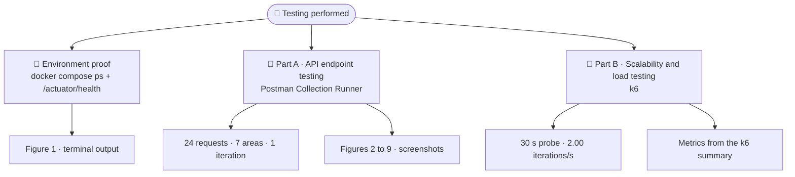

### 🗂️ Evidence layout in the repository

```text
docs/
├── API_TESTING_REPORT.md                      ← this document
└── api-testing-evidence/
    ├── 01-terminal-stack-health.png           🖥️  stack status and health (generated from terminal output)
    ├── 02-postman-run-order-part1.png         ⚙️  run order and configuration, part 1
    ├── 03-postman-run-order-part2.png         ⚙️  run order and configuration, part 2
    ├── 04-postman-results-health-auth.png     ▶️  results: health, register, login
    ├── 05-postman-results-auth-profile.png    ▶️  results: refresh, profile, MFA, current user
    ├── 06-postman-results-users-search.png    ▶️  results: users, profile update, doctor search
    ├── 07-postman-results-doctors.png         ▶️  results: doctors and slots
    ├── 08-postman-results-consultations.png   ▶️  results: consultations
    └── 09-postman-results-payments-admin.png  ▶️  results: payments and admin analytics
```

---

## 🧱 Environment and stack health

The backend ran as a Docker Compose stack of three containers. Figure 1 shows the container status and the Actuator health response.

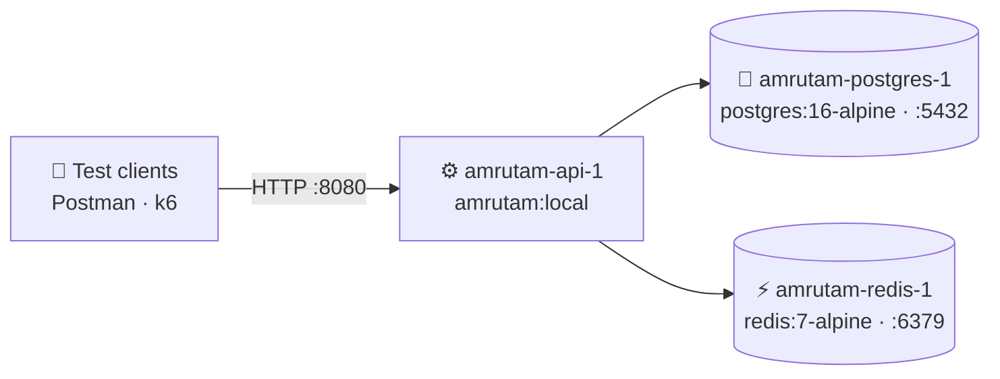

### Figure 1: Container status and health check

<p align="center">
  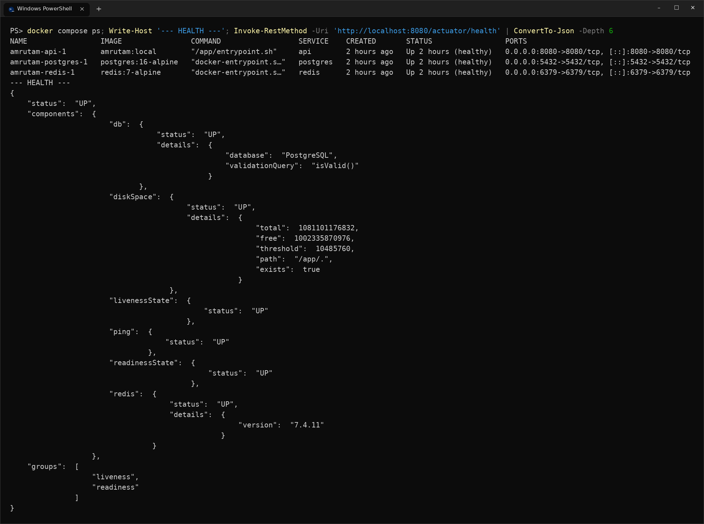
  <br><em>Figure 1. Output of <code>docker compose ps</code> followed by <code>Invoke-RestMethod http://localhost:8080/actuator/health</code>. Rendered as a terminal-style image from the captured command output (the full text is in the collapsible block below). Click the image to view it at full resolution.</em>
</p>

| Container | Image | Status | Published port |
| --- | --- | --- | --- |
| `amrutam-api-1` | `amrutam:local` | Up 2 hours (healthy) | 8080 |
| `amrutam-postgres-1` | `postgres:16-alpine` | Up 2 hours (healthy) | 5432 |
| `amrutam-redis-1` | `redis:7-alpine` | Up 2 hours (healthy) | 6379 |

| Health component | Status | Detail in the output |
| --- | --- | --- |
| Overall | ✅ UP | groups: liveness, readiness |
| `db` | ✅ UP | PostgreSQL, `isValid()` validation query |
| `redis` | ✅ UP | version 7.4.11 |
| `diskSpace` | ✅ UP | path `/app/.` exists |
| `livenessState` · `readinessState` · `ping` | ✅ UP | none |

<details>
<summary>📄 Full terminal text behind Figure 1 (copyable)</summary>

```powershell
docker compose ps; Write-Host '--- HEALTH ---'; Invoke-RestMethod -Uri 'http://localhost:8080/actuator/health' | ConvertTo-Json -Depth 6
```

```text
NAME                 IMAGE                COMMAND                  SERVICE    CREATED       STATUS                 PORTS
amrutam-api-1        amrutam:local        "/app/entrypoint.sh"     api        2 hours ago   Up 2 hours (healthy)   0.0.0.0:8080->8080/tcp, [::]:8080->8080/tcp
amrutam-postgres-1   postgres:16-alpine   "docker-entrypoint.s…"   postgres   2 hours ago   Up 2 hours (healthy)   0.0.0.0:5432->5432/tcp, [::]:5432->5432/tcp
amrutam-redis-1      redis:7-alpine       "docker-entrypoint.s…"   redis      2 hours ago   Up 2 hours (healthy)   0.0.0.0:6379->6379/tcp, [::]:6379->6379/tcp
--- HEALTH ---
{
    "status":  "UP",
    "components":  {
                       "db":  {
                                  "status":  "UP",
                                  "details":  {
                                                  "database":  "PostgreSQL",
                                                  "validationQuery":  "isValid()"
                                              }
                              },
                       "diskSpace":  {
                                         "status":  "UP",
                                         "details":  {
                                                         "total":  1081101176832,
                                                         "free":  1002335870976,
                                                         "threshold":  10485760,
                                                         "path":  "/app/.",
                                                         "exists":  true
                                                     }
                                     },
                       "livenessState":  {
                                             "status":  "UP"
                                         },
                       "ping":  {
                                    "status":  "UP"
                                },
                       "readinessState":  {
                                              "status":  "UP"
                                          },
                       "redis":  {
                                     "status":  "UP",
                                     "details":  {
                                                     "version":  "7.4.11"
                                                 }
                                 }
                   },
    "groups":  [
                   "liveness",
                   "readiness"
               ]
}
```

</details>

---

## 🧪 Part A: API endpoint testing (Postman)

### Scope

The collection **Amrutam API - Realistic Smoke & Flow Tests** was run with the Postman Collection Runner against `http://localhost:8080`. It covers 24 requests, grouped here by area from the request names and the run order.

```text
Amrutam API - Realistic Smoke & Flow Tests
├── 🩺 Health ............... Actuator Health
├── 🔐 Authentication ....... Register Patient · Admin Login · Refresh Token · Get My Profile · MFA Verify
├── 👤 Users ................ Get Current User · List Users · Update Profile
├── 🧑‍⚕️ Doctors .............. Search Doctors · Create Doctor · Get Doctor By ID · Get Doctor Availability · Create Doctor Slot
├── 📅 Consultations ........ List · Book · Get By ID · Cancel · Complete
├── 💳 Payments ............. Capture Payment · Refund Payment
└── 📊 Admin Analytics ...... Daily Consultations · Revenue Summary · System Health Snapshot
```

### Run configuration

| Setting | Value |
| --- | --- |
| Source | Runner |
| Environment | None |
| Iterations | 1 |
| Delay | 0 ms |
| Data file | none selected |
| Persist responses for a session | unchecked |
| Run started | today at 23:56:10 |
| Duration | 3 s 934 ms |
| Average response time | 79 ms |
| Scripted assertions ("All tests") | 1 passed · 0 failed · 0 skipped |

### Figures 2 and 3: Run order and configuration

<p align="center">
  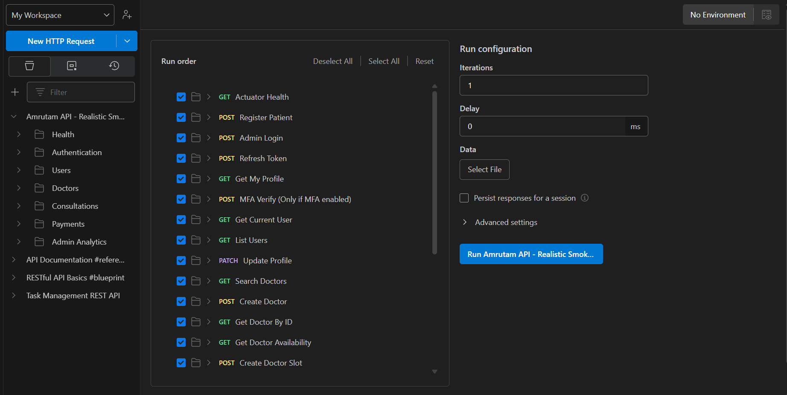
  <br><em>Figure 2. Runner setup, part 1: all requests ticked, from Actuator Health to Create Doctor Slot. Configuration shows Iterations 1, Delay 0 ms, no data file.</em>
</p>

<p align="center">
  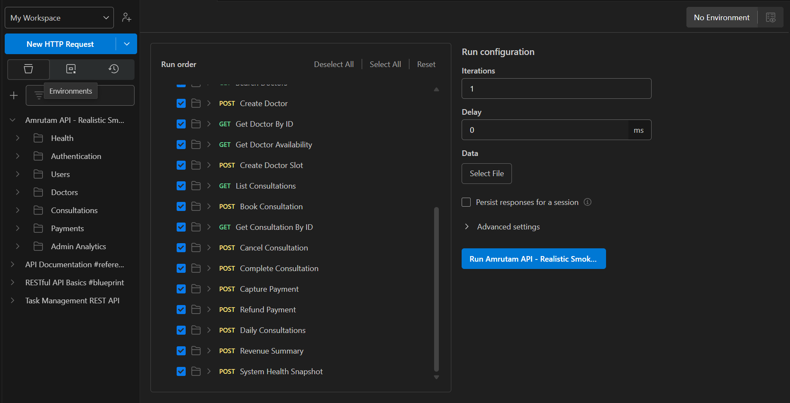
  <br><em>Figure 3. Runner setup, part 2: the list continues through the consultation, payment and admin analytics requests and ends with System Health Snapshot.</em>
</p>

### Run flow and outcome

Each request in execution order, coloured by the status the runner reported.

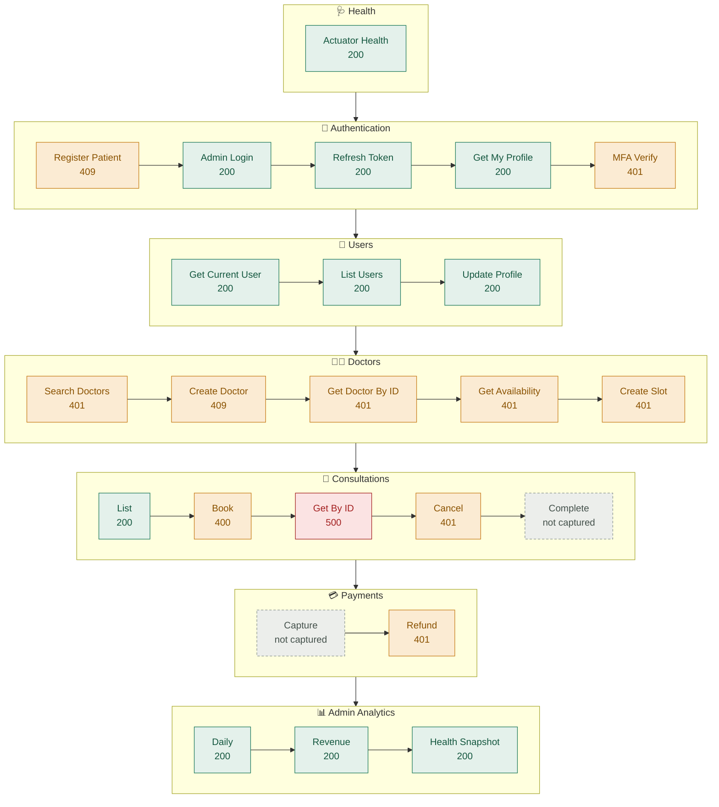

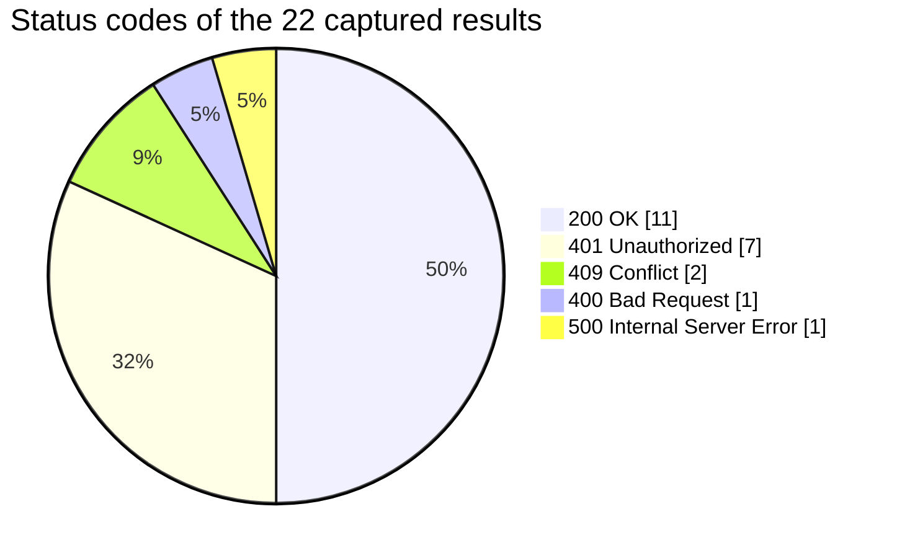

| Area | Requests | Results captured | 200 OK | Other statuses |
| --- | --- | --- | --- | --- |
| 🩺 Health | 1 | 1 | 1 | none |
| 🔐 Authentication | 5 | 5 | 3 | 409 (register), 401 (MFA verify) |
| 👤 Users | 3 | 3 | 3 | none |
| 🧑‍⚕️ Doctors | 5 | 5 | 0 | 401 × 4, 409 × 1 |
| 📅 Consultations | 5 | 4 | 1 | 400, 500, 401 |
| 💳 Payments | 2 | 1 | 0 | 401 (refund) |
| 📊 Admin Analytics | 3 | 3 | 3 | none |
| **Total** | **24** | **22** | **11** | **11** |

### Results by area

#### 🩺🔐 Health and authentication (Figures 4 and 5)

<p align="center">
  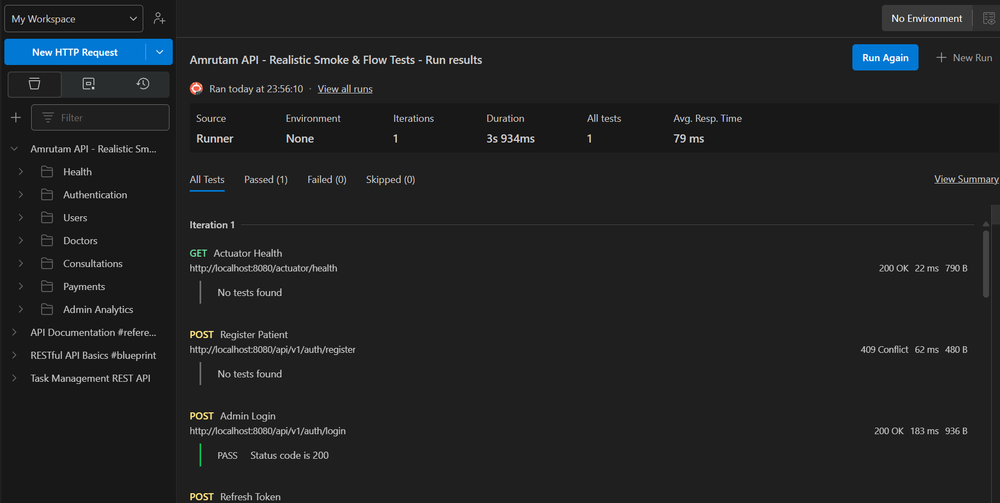
  <br><em>Figure 4. Start of the run: health check, patient registration and admin login. Admin Login shows the only scripted assertion, "Status code is 200", as PASS.</em>
</p>

<p align="center">
  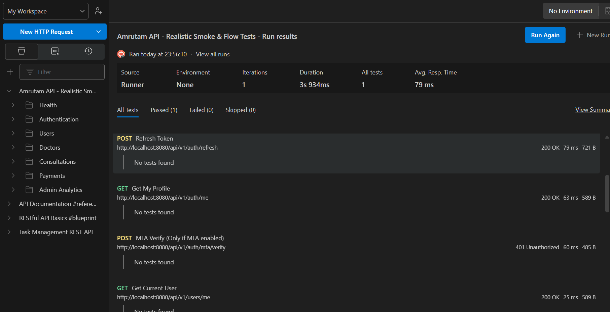
  <br><em>Figure 5. Token refresh, own profile, MFA verification and current user.</em>
</p>

| Request | Endpoint | Status | Time | Size |
| --- | --- | --- | --- | --- |
| GET Actuator Health | `/actuator/health` | ✅ 200 OK | 22 ms | 790 B |
| POST Register Patient | `/api/v1/auth/register` | ⚠️ 409 Conflict | 62 ms | 480 B |
| POST Admin Login | `/api/v1/auth/login` | ✅ 200 OK | 183 ms | 936 B |
| POST Refresh Token | `/api/v1/auth/refresh` | ✅ 200 OK | 79 ms | 721 B |
| GET Get My Profile | `/api/v1/auth/me` | ✅ 200 OK | 63 ms | 589 B |
| POST MFA Verify (only if MFA enabled) | `/api/v1/auth/mfa/verify` | ⚠️ 401 Unauthorized | 60 ms | 485 B |

#### 👤 Users and doctor search (Figure 6)

<p align="center">
  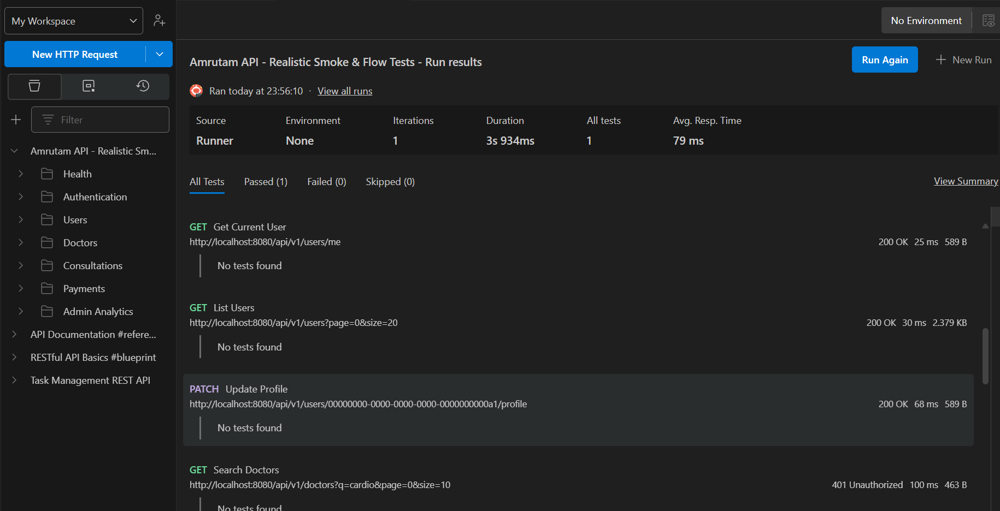
  <br><em>Figure 6. User endpoints and the first doctors request. Get Current User also appears at the bottom of Figure 5 (the same request, counted once).</em>
</p>

| Request | Endpoint | Status | Time | Size |
| --- | --- | --- | --- | --- |
| GET Get Current User | `/api/v1/users/me` | ✅ 200 OK | 25 ms | 589 B |
| GET List Users | `/api/v1/users?page=0&size=20` | ✅ 200 OK | 30 ms | 2.379 KB |
| PATCH Update Profile | `/api/v1/users/00000000-0000-0000-0000-0000000000a1/profile` | ✅ 200 OK | 68 ms | 589 B |
| GET Search Doctors | `/api/v1/doctors?q=cardio&page=0&size=10` | ⚠️ 401 Unauthorized | 100 ms | 463 B |

#### 🧑‍⚕️ Doctors (Figure 7)

<p align="center">
  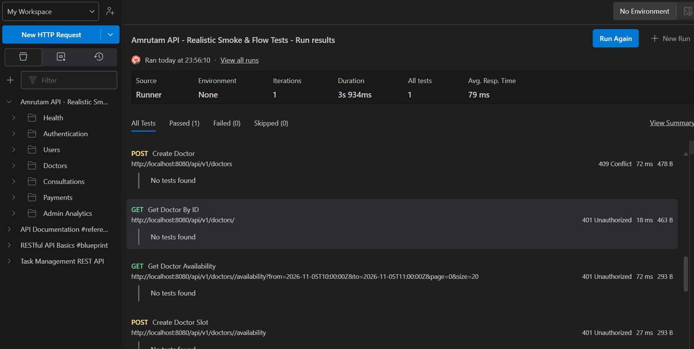
  <br><em>Figure 7. Doctor creation, lookup, availability and slot creation. The URLs for the last three requests contain an empty ID segment.</em>
</p>

| Request | Endpoint as shown | Status | Time | Size |
| --- | --- | --- | --- | --- |
| POST Create Doctor | `/api/v1/doctors` | ⚠️ 409 Conflict | 72 ms | 478 B |
| GET Get Doctor By ID | `/api/v1/doctors/` | ⚠️ 401 Unauthorized | 18 ms | 463 B |
| GET Get Doctor Availability | `/api/v1/doctors//availability?from=2026-11-05T10:00:00Z&to=2026-11-05T11:00:00Z&page=0&size=20` | ⚠️ 401 Unauthorized | 72 ms | 293 B |
| POST Create Doctor Slot | `/api/v1/doctors//availability` | ⚠️ 401 Unauthorized | 27 ms | 293 B |

#### 📅 Consultations (Figure 8)

<p align="center">
  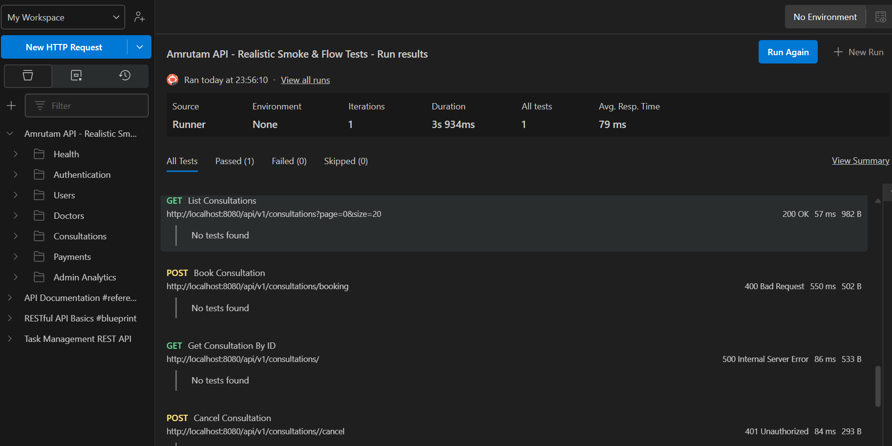
  <br><em>Figure 8. Consultation listing, booking, lookup and cancellation.</em>
</p>

| Request | Endpoint as shown | Status | Time | Size |
| --- | --- | --- | --- | --- |
| GET List Consultations | `/api/v1/consultations?page=0&size=20` | ✅ 200 OK | 57 ms | 982 B |
| POST Book Consultation | `/api/v1/consultations/booking` | ⚠️ 400 Bad Request | 550 ms | 502 B |
| GET Get Consultation By ID | `/api/v1/consultations/` | ❌ 500 Internal Server Error | 86 ms | 533 B |
| POST Cancel Consultation | `/api/v1/consultations//cancel` | ⚠️ 401 Unauthorized | 84 ms | 293 B |

#### 💳📊 Payments and admin analytics (Figure 9)

<p align="center">
  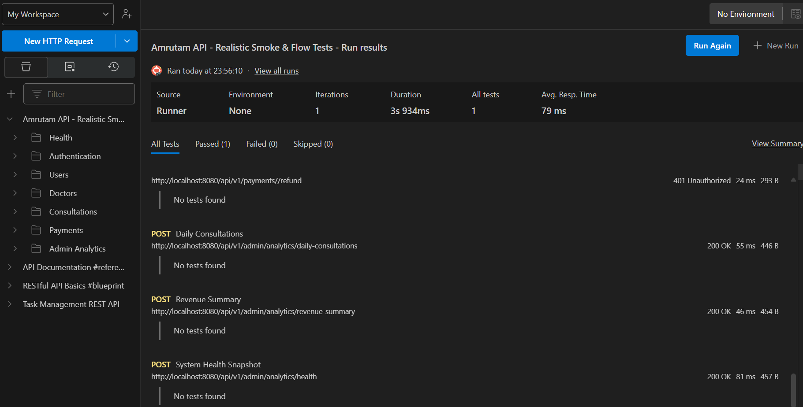
  <br><em>Figure 9. End of the run. The first entry is cut off at the top of the screenshot; it is identified as Refund Payment from its URL and the run order.</em>
</p>

| Request | Endpoint as shown | Status | Time | Size |
| --- | --- | --- | --- | --- |
| POST Refund Payment | `/api/v1/payments//refund` | ⚠️ 401 Unauthorized | 24 ms | 293 B |
| POST Daily Consultations | `/api/v1/admin/analytics/daily-consultations` | ✅ 200 OK | 55 ms | 446 B |
| POST Revenue Summary | `/api/v1/admin/analytics/revenue-summary` | ✅ 200 OK | 46 ms | 454 B |
| POST System Health Snapshot | `/api/v1/admin/analytics/health` | ✅ 200 OK | 81 ms | 457 B |

### Response times (from the screenshots)

| Measure | Value |
| --- | --- |
| Fastest visible response | 18 ms (Get Doctor By ID) |
| Slowest visible response | 550 ms (Book Consultation) |
| Runner-reported average | 79 ms |
| Admin analytics endpoints | 46 to 81 ms |

> [!NOTE]
> Complete Consultation and Capture Payment are in the run order (Figure 3), but their results are not visible in any screenshot, so they are marked "not captured" rather than assumed.

---

## 🚀 Part B: Scalability and load testing (k6)

### Requirement versus measured result

The two columns below are kept separate on purpose: the left is what the assignment asks for, the right is what the k6 run measured.

| Aspect | 📋 Required (assignment) | 📈 Measured (k6 run) |
| --- | --- | --- |
| Daily consultation volume | 100,000 per day, about 1.16 per second (calculated: 100,000 ÷ 86,400) | 2.00 iterations per second, about **172,800 per day equivalent** (2.00 × 86,400) |
| Comparison with target | baseline | about 1.73 × the required rate (calculated: 172,800 ÷ 100,000) |
| Latency | p95 under 200 ms for reads, under 500 ms for writes | p95 **205.77 ms**, average **128.88 ms** (one aggregate figure; not split into reads and writes) |
| Errors | not given as a number | HTTP failures **0.00%** |
| Availability | 99.95% | not assessed by this 30-second run |

```text
Daily-equivalent consultations (1 block ≈ 3,333 per day)

Required target   │██████████████████████████████                 100,000
Measured (k6)     │████████████████████████████████████████████████████  172,800  (rate-equivalent)
```

### Test design

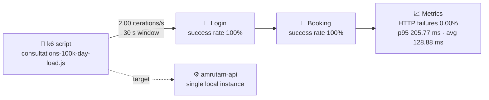

### Measured results

| Metric | Value |
| --- | --- |
| Duration | 30 seconds |
| Successful booking iterations | **61** |
| Throughput | **2.00 iterations/s** |
| Equivalent daily rate | **about 172,800 consultations per day** |
| HTTP failures | **0.00%** |
| Login success rate | **100.00%** |
| Booking success rate | **100.00%** |
| p95 latency | **205.77 ms** |
| Average response time | **128.88 ms** |
| Load script | `consultations-100k-day-load.js` |

### How to read these numbers

- **Volume:** the daily figure is the measured rate multiplied by 86,400 seconds. It describes the rate the backend sustained during the 30-second window; it is not the result of a 24-hour run.
- **Capacity:** the probe ran at a fixed rate and recorded no failures. It shows the backend sustained that rate, but it does not find the maximum rate the backend can handle.
- **Latency:** the p95 of 205.77 ms is below the 500 ms write target. It is 5.77 ms above the 200 ms read target, but the figure is one aggregate over the whole run and is not split by request type, so the read target is not evaluated separately here.
- **Reliability:** zero HTTP failures and 100% login and booking success mean no failed requests were recorded in this run. The 99.95% availability target needs a much longer observation window.
- **Rounding:** 61 iterations in 30 seconds is about 2.03 per second by simple division; the reported throughput of 2.00 per second is used for the daily-equivalent figure.

---

## 🔎 Open items and limitations

| # | Item | Detail |
| --- | --- | --- |
| 1 | Non-2xx Postman responses | 401 on MFA Verify, Search Doctors, Get Doctor By ID, Get Doctor Availability, Create Doctor Slot, Cancel Consultation and Refund Payment; 409 on Register Patient and Create Doctor; 400 on Book Consultation; 500 on Get Consultation By ID. Response bodies were not captured, so the causes are not established here. |
| 2 | Empty IDs in URLs | Six requests show an empty segment where an ID would be expected (for example `/api/v1/doctors/` and `/api/v1/consultations//cancel`). |
| 3 | Missing results | Complete Consultation and Capture Payment appear in the run order but have no visible result. |
| 4 | Assertions | Only Admin Login has a scripted assertion. All other requests show "No tests found", so their outcome is the HTTP status only. |
| 5 | Two result sets, different scope | The Postman run is a single-iteration smoke and flow check; its Book Consultation request returned 400. The k6 run reports a 100% booking success rate for its own login and booking flow. The two runs test different things and this report does not reconcile them. |
| 6 | k6 evidence | The k6 values come from the recorded summary of the run; no k6 screenshot is included. |
| 7 | Load test scale | One 30-second run on a single local API instance in Docker; no 24-hour soak, no multi-instance test, and no ramp to find the capacity limit. |
| 8 | Latency breakdown | The reported p95 is a single aggregate; per-request-type (read versus write) percentiles were not provided. |

## 🏁 Conclusion

- **Environment:** the three-container stack (API, PostgreSQL, Redis) was running and healthy, and the Actuator health endpoint reported every component UP (Figure 1).
- **API endpoints (Part A):** all 24 requests in the collection were executed. Of the 22 results captured, 11 returned 200 OK, including health, login, token refresh, profile and user endpoints, consultation listing and all three admin analytics endpoints. The remaining 11 returned 4xx or 5xx statuses and are listed as open items.
- **Scalability (Part B):** at a rate equivalent to about 172,800 consultations per day, the backend recorded 0.00% HTTP failures, 100% login and booking success, a 205.77 ms p95 and a 128.88 ms average over 30 seconds. This exceeds the 100,000 per day requirement as a sustained-rate measurement; it is not a 24-hour test and not a capacity limit.

---

## 🧾 Evidence index

| Figure | Section | Content | File |
| --- | --- | --- | --- |
| 1 | Environment | Container status and health response (terminal-style image) | `api-testing-evidence/01-terminal-stack-health.png` |
| 2 | Postman setup | Run order and configuration, part 1 | `api-testing-evidence/02-postman-run-order-part1.png` |
| 3 | Postman setup | Run order and configuration, part 2 | `api-testing-evidence/03-postman-run-order-part2.png` |
| 4 | Postman results | Health, register, login | `api-testing-evidence/04-postman-results-health-auth.png` |
| 5 | Postman results | Refresh, profile, MFA, current user | `api-testing-evidence/05-postman-results-auth-profile.png` |
| 6 | Postman results | Users, profile update, doctor search | `api-testing-evidence/06-postman-results-users-search.png` |
| 7 | Postman results | Doctors and slots | `api-testing-evidence/07-postman-results-doctors.png` |
| 8 | Postman results | Consultations | `api-testing-evidence/08-postman-results-consultations.png` |
| 9 | Postman results | Payments and admin analytics | `api-testing-evidence/09-postman-results-payments-admin.png` |