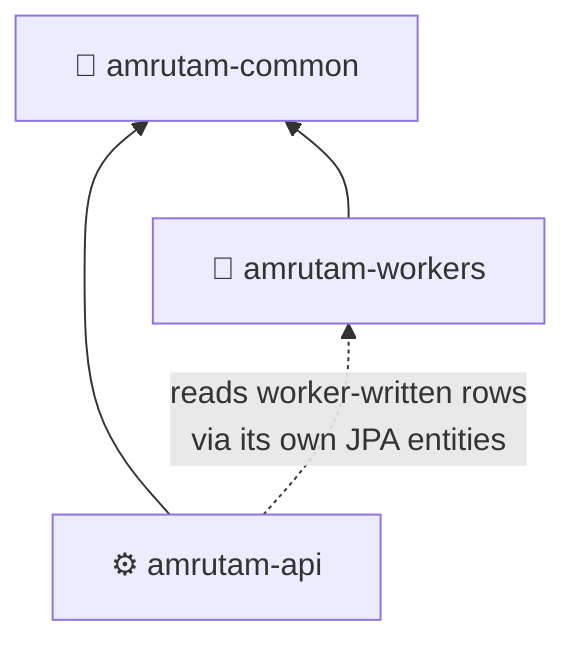
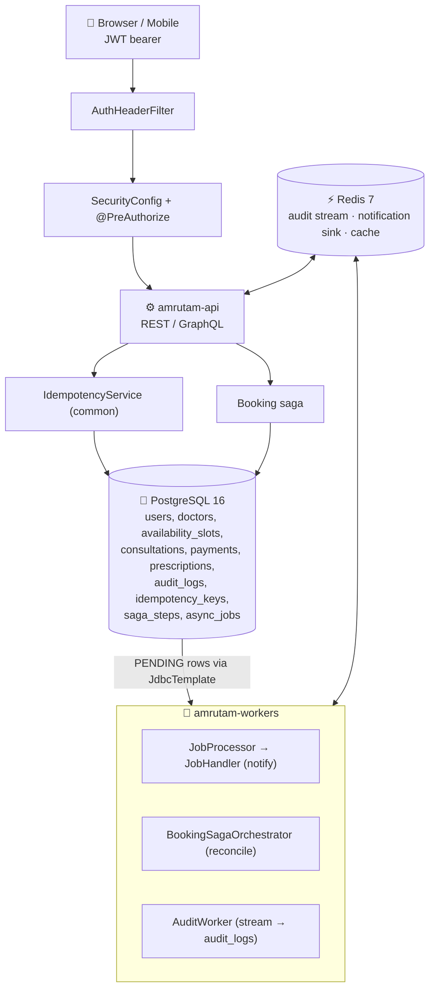
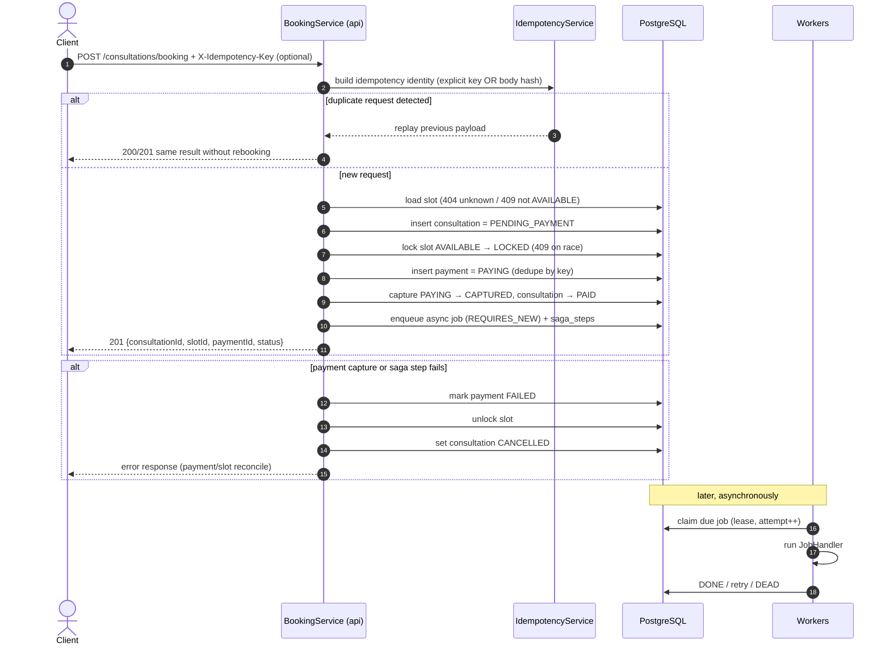
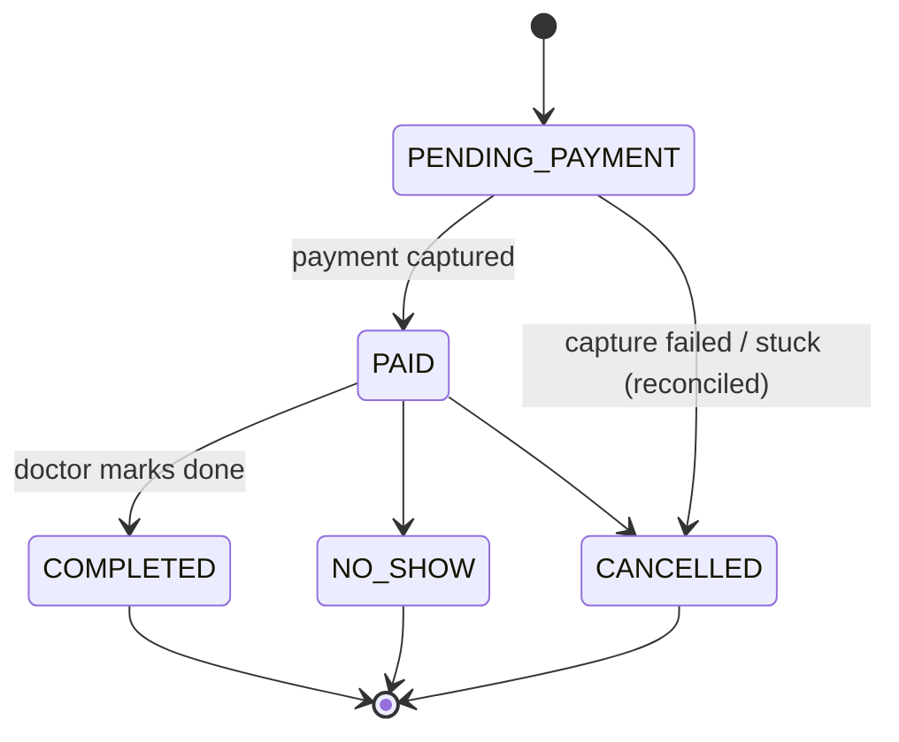
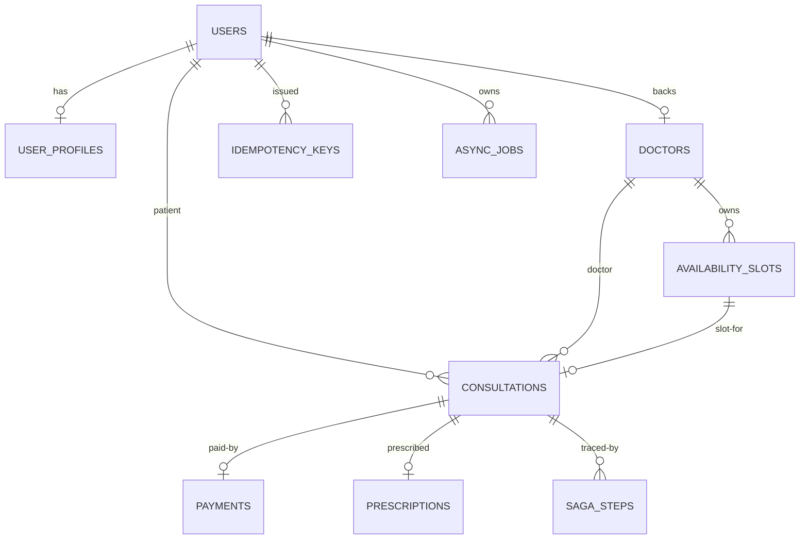
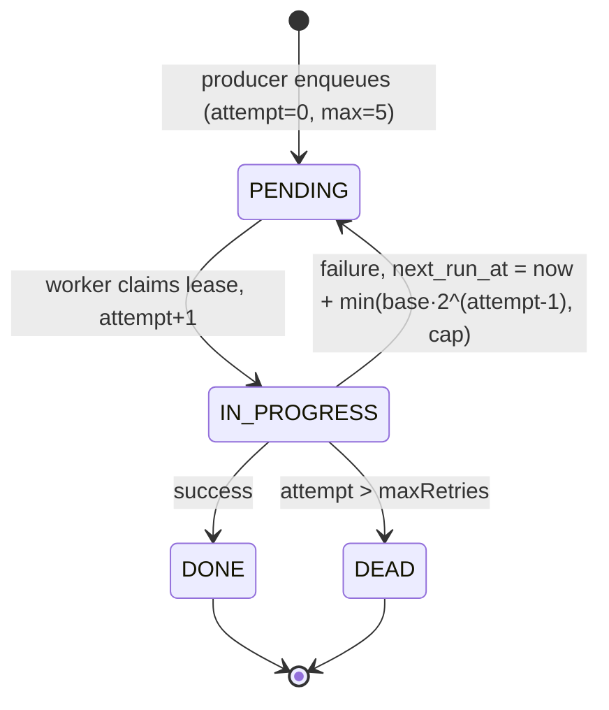

# 🧩 Amrutam Architecture (Deep Dive)

> Module map · data flow · booking saga · ER model · async workers · caching · partitioning · disaster recovery

**Contents:** [1 Overview](#1--overview) · [2 Boundaries](#2--module-boundaries) · [3 Data flow](#3--data-flow) · [4 Booking saga](#4--booking-saga) · [5 ER diagram](#5--er-diagram) · [6 Async jobs](#6--async-jobs) · [7 Caching](#7--caching) · [8 Partitioning](#8--partitioning) · [9 DR](#9--dr--backup)

---

## 1. 🔭 Overview

Amrutam is a Java 21 / Spring Boot 3.3.x telemedicine backend: three Maven modules plus shared infrastructure (PostgreSQL 16 + Redis 7).

| Module | Responsibility | Owns |
| --- | --- | --- |
| 🧱 `amrutam-common` | Shared kernel: JWT filter, `JwTokenService`, claims, exceptions, idempotency SPI, rate limiting, audit SPI, MDC trace-id | No tables, only SPIs and beans |
| ⚙️ `amrutam-api` | REST + GraphQL surface, booking saga, JPA persistence | **All** entities and repositories, `schema.sql`, `data.sql`, `async_jobs` / `saga_steps` producers |
| 🔄 `amrutam-workers` | Job poller, saga reconciliation, notification fan-out, audit stream consumer | No entities, raw `JdbcTemplate` SQL only |



> [!NOTE]
> The dotted edge is a **data** relationship only. The API never has a compile-time import of worker classes, so the module graph stays acyclic.

## 2. 🧱 Module boundaries

Single source of truth for the schema lives in `amrutam-api`. Every entity and repository, including worker-facing `async_jobs`, `saga_steps` and `audit_logs`, is declared under `amrutam-api/src/main/java/com/amrutam/api/{entity,repository}`.

```text
amrutam-api
└── src/main/java/com/amrutam/api
    ├── entity/        ✅ ALL JPA entities live here
    └── repository/    ✅ ALL Spring Data repositories live here

amrutam-workers
└── (no entity/, no repository/)   ❌ never imports com.amrutam.api.**
    ├── JdbcTemplateJobStore       parameterized SQL
    └── AuditLogWriter             parameterized SQL
```

**Consequences**

- Workers reach the DB with parameterized `JdbcTemplate` SQL against the same tables.
- Both processes share one datasource, so schema changes are made once in `schema.sql` / the JPA model and redeployed to both.
- A new worker table means: DDL + entity in the API first, then plain SQL from workers.

## 3. 🌊 Data flow



## 4. 💳 Booking saga

### 4.1 Sequence



| # | Step | Detail |
| --- | --- | --- |
| 0 | Idempotency gate | `X-Idempotency-Key` overrides the body hash; duplicate requests replay the same response instead of creating a second booking |
| 1 | Load slot | `404` unknown, `409` not `AVAILABLE` |
| 2 | Create consultation | Status `PENDING_PAYMENT`, `scheduledAt = slot.startAt` |
| 3 | Lock slot | Atomic `UPDATE … WHERE status='AVAILABLE'`; 0 rows means a competing booking won, so `ConflictException` (409) |
| 4 | Create payment | Status `PAYING`; duplicate idempotency key returns the existing payment, no second charge |
| 5 | Capture | `PAYING → CAPTURED` (simulated gateway); consultation becomes `PAID`; on failure, compensation runs in the same transaction |
| 6 | Compensation | If capture fails: `payments.markFailed` → `slots.unlockSlot` → consultation `CANCELLED`; saga step is recorded for traceability |
| 7 | Enqueue | `consultation.scheduled-notification` job written via `REQUIRES_NEW` (durable even if the outer transaction rolls back), plus `saga_steps` rows |

### 4.2 Consultation state machine



### 4.3 Compensation matrix

| Failed step | Compensation (reverse order) |
| --- | --- |
| 5 · capture fails | `payments.markFailed` → `slots.unlockSlot` → consultation `CANCELLED` → saga step "compensation" |
| 4 · payment insert fails | Nothing created yet; outer transaction rolls back |
| 3 · lock race | `ConflictException` (409); consultation rolls back |
| 1 · slot missing | `NotFoundException` (404) |

> [!WARNING]
> A `PENDING_PAYMENT` consultation that never reaches `PAID` (crash between steps 4 and 5) is picked up by the workers' `BookingSagaOrchestrator`, which releases the slot and cancels it. This is the out-of-band backstop.

## 5. 🗂️ ER diagram



Full column-level diagram: [database-architecture.md](database-architecture.md).

## 6. ♻️ Async jobs



- **Producer:** `JdbcAsyncBridge.enqueueAsyncJob` writes a `PENDING` row (`next_run_at NULL` = due immediately).
- **Consumer:** workers poll `findDueJobs(before)` and claim under a lease.
- **Health:** `countByStatus(PENDING)` and `countByStatus(DEAD)` feed the admin `SystemHealthResponse`.

## 7. ⚡ Caching

`CacheConfig` uses `RedisCacheManager` when `amrutam.cache.redis-enabled=true` (default), otherwise an in-memory manager with identical TTLs. Null values are not cached.

| Cache | TTL | Namespace |
| --- | --- | --- |
| users | 5 m | `users:*` |
| doctors | 15 m | `doctors:*` |
| availability | 60 s | `availability:<doctorId>:<from>:<to>` |
| consultations | 30 s | `consultations:*` |
| analytics | 5 m | `analytics:*` |

## 8. 📦 Partitioning (future ops step)

`schema.sql` is a single-partition baseline today. Planned path as data grows:

| Table | Strategy |
| --- | --- |
| `consultations` | RANGE by `scheduled_at` (monthly) |
| `audit_logs` | RANGE by `occurred_at` (weekly) |
| `payments`, `idempotency_keys` | RANGE by `created_at` when hot |

> [!NOTE]
> Adopt a managed migration tool (e.g. Flyway) later. `spring.sql.init.mode=always` + `schema.sql` is the dev/docker path only.

## 9. 🛟 DR / backup

| Component | Strategy | Targets |
| --- | --- | --- |
| PostgreSQL | `pg_dump` logical backups; PITR via WAL archiving as follow-up | RPO 15 min, RTO < 30 min for standby |
| Redis | AOF `everysec`; cache is rebuildable | May lose up to one TTL window after restart |
| `async_jobs` / `saga_steps` | Live in Postgres, inherit its RPO/RTO | Mid-saga crash recovered by `BookingSagaOrchestrator` sweep |