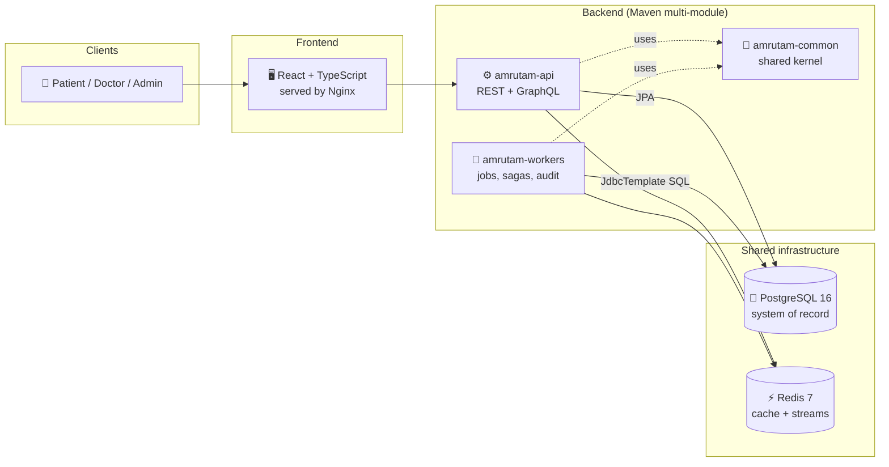
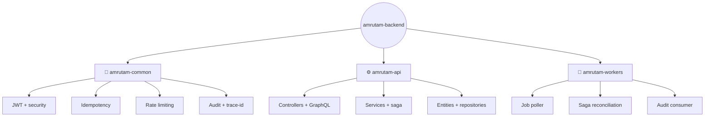
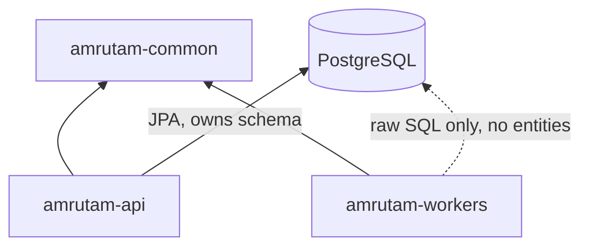
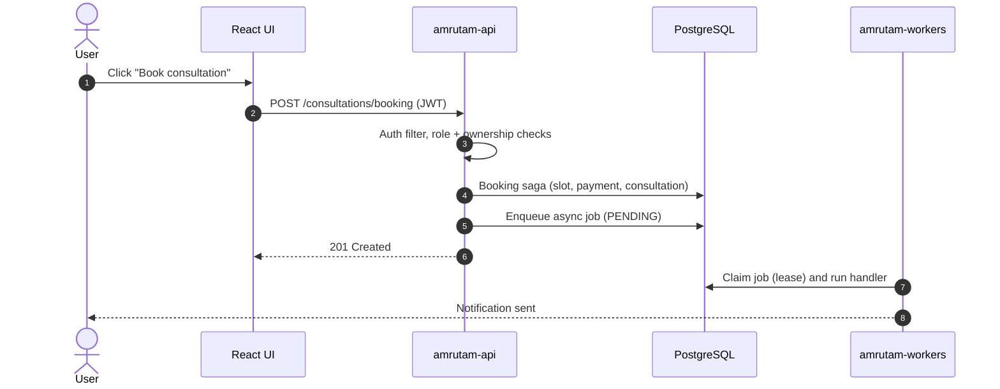

# 🏛️ Architecture Overview

<!-- docs-nav -->
<p align="center"><sub><a href="README.md">Hub</a> · <b>Overview</b> · <a href="ARCHITECTURE.md">Deep dive</a> · <a href="backend-architecture.md">Backend</a> · <a href="frontend-architecture.md">Frontend</a> · <a href="database-architecture.md">Database</a> · <a href="authentication-architecture.md">Auth</a> · <a href="api-endpoints.md">API</a> · <a href="SECURITY.md">Security</a> · <a href="tech-stack.md">Stack</a> · <a href="configuration-and-environment.md">Config</a> · <a href="setup.md">Setup</a> · <a href="observability.md">Observability</a> · <a href="testing.md">Testing</a> · <a href="troubleshooting.md">Troubleshooting</a></sub></p>


> A concise, end-to-end view of Amrutam. For the deep dive (saga, ER model, caching, DR) read [ARCHITECTURE.md](ARCHITECTURE.md).

**Contents:** [Big picture](#-big-picture) · [Module tree](#-module-tree) · [Dependencies](#-dependency-direction) · [Request flow](#-request-lifecycle) · [Design principles](#-design-principles)

---

## 🌍 Big picture

Amrutam connects **patients**, **doctors** and **admins**. A React frontend talks to a Spring Boot API; a separate worker process handles background work. PostgreSQL is the system of record, Redis supports caching and streams.



## 🌳 Module tree

The backend is one parent project with three modules:

```text
amrutam-backend/
├── 🧱 amrutam-common        shared kernel (no tables)
│   ├── security/            JWT filter, token service, claims
│   ├── exceptions/          custom exceptions + API error bodies
│   ├── idempotency/         SPI + default implementation
│   ├── ratelimit/           token-bucket filter
│   ├── audit/               audit SPI
│   └── trace/               MDC trace-id propagation
│
├── ⚙️ amrutam-api           the entry point (owns the schema)
│   ├── controller/          REST controllers
│   ├── graphql/             resolvers
│   ├── service/             domain logic, booking saga
│   ├── entity/              ALL JPA entities
│   ├── repository/          ALL Spring Data repositories
│   └── resources/           schema.sql, data.sql, application-*.yml
│
└── 🔄 amrutam-workers       background processing (no entities)
    ├── JobProcessor         polls async_jobs, runs handlers
    ├── BookingSagaOrchestrator   reconciles stuck sagas
    ├── AuditWorker          Redis stream → audit_logs
    └── JdbcTemplateJobStore raw parameterized SQL
```

### Same tree as a graph



## 🔗 Dependency direction



> [!IMPORTANT]
> **Persistence ownership rule:** only `amrutam-api` defines JPA entities and repositories. Workers use parameterized `JdbcTemplate` SQL and never import `com.amrutam.api.**`. New table? Add DDL + entity in the API first, then reference it from workers.

## 🔄 Request lifecycle



## 🎯 Design principles

| Principle | How it shows up |
| --- | --- |
| Single source of truth | API owns the schema, workers follow |
| Fail safely | Saga compensation + worker reconciliation backstop |
| Secure by default | JWT, role checks, ownership checks, rate limits |
| Observable | Actuator, structured logs, trace-id on every response |
| Container-first | One command starts the whole stack |

<!-- docs-footer -->
---

<p align="center">🏠 <a href="README.md">Docs hub</a> · <a href="ARCHITECTURE.md">Deep dive</a> ➡️</p>