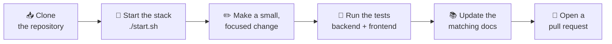

# 🤝 Contributing to Amrutam

<!-- docs-nav -->
<p align="center"><sub><a href="README.md">Hub</a> · <a href="Architecture-overview.md">Overview</a> · <a href="ARCHITECTURE.md">Deep dive</a> · <a href="backend-architecture.md">Backend</a> · <a href="frontend-architecture.md">Frontend</a> · <a href="database-architecture.md">Database</a> · <a href="authentication-architecture.md">Auth</a> · <a href="api-endpoints.md">API</a> · <a href="SECURITY.md">Security</a> · <a href="tech-stack.md">Stack</a> · <a href="configuration-and-environment.md">Config</a> · <a href="setup.md">Setup</a> · <a href="observability.md">Observability</a> · <a href="testing.md">Testing</a> · <a href="troubleshooting.md">Troubleshooting</a></sub></p>

> Thank you for helping improve the Amrutam telemedicine platform.

**Contents:** [Ways to contribute](#-ways-to-contribute) · [Workflow](#-contribution-workflow) · [Local setup](#-local-setup) · [Pull requests](#-branching-and-pull-requests) · [Code quality](#-code-quality-expectations) · [Testing](#-testing) · [Security](#-security-reporting) · [Docs](#-documentation-updates)

---

## 💡 Ways to contribute

| | Contribution | Examples |
| --- | --- | --- |
| 🐛 | **Report bugs** | Reproducible problems in the API or UI |
| 🔐 | **Report security issues** | Privately, see [Security reporting](#-security-reporting) |
| ✨ | **Improve behaviour** | API or UI changes that follow the documented architecture |
| 🧪 | **Add tests** | Regression coverage for fixed bugs |
| 📚 | **Improve docs** | Architecture notes and guides |
| 🚀 | **Propose improvements** | Operational or deployment changes |

## 🔄 Contribution workflow



## ⚙️ Local setup

1. **Clone** the repository.
2. **Start the local stack** from the repo root:

| Platform | Command |
| --- | --- |
| macOS / Linux / Git Bash | `./start.sh` |
| Windows PowerShell | `./start.ps1` |

```bash
./start.sh
```

```powershell
./start.ps1
```

3. **Validate** the API health endpoint:

```bash
curl http://localhost:8080/actuator/health
```

> [!TIP]
> Ports, URLs and the services that start are listed in [setup.md](setup.md). If something does not start, see [troubleshooting.md](troubleshooting.md).

## 🔀 Branching and pull requests

- Keep changes **small and focused**.
- Prefer a **single responsibility** per pull request.
- Add or update documentation for user-visible behaviour changes.

### Pull request checklist

- [ ] The pull request has one responsibility
- [ ] The description states the **problem**, the **root cause** and the **fix**
- [ ] Any runtime or environment assumptions are mentioned
- [ ] Tests are added or updated where behaviour changed
- [ ] Documentation is updated for user-visible changes
- [ ] No secrets or real credentials are committed

## ✅ Code quality expectations

| Expectation | Detail |
| --- | --- |
| 🏛️ Follow the architecture | Keep backend and frontend changes aligned with the [documented architecture](Architecture-overview.md) |
| ♻️ Reuse patterns | Prefer existing patterns over introducing ad hoc implementations |
| 🔒 No secrets | Do not commit secrets or real credentials |
| ⚙️ Configuration | When changing runtime configuration, update the relevant documentation |

## 🧪 Testing

| Layer | Folder | Commands |
| --- | --- | --- |
| ☕ Backend | `backend/` | `mvn test` |
| 🖥️ Frontend | `frontend/` | `npm install`, then `npm run test:run` |

```bash
# Backend
cd backend
mvn test
```

```bash
# Frontend
cd frontend
npm install
npm run test:run
```

Verified results and the load and API test evidence are in [testing.md](testing.md).

## 🔐 Security reporting

> [!WARNING]
> **Do not open public issues for verified security issues.** Use private disclosure through the project maintainer or your designated security contact.

## 📚 Documentation updates

If you change the runtime model, endpoints, auth behaviour or deployment flow, update the matching document in the docs folder.

| If you change… | Update |
| --- | --- |
| Runtime model or startup | [setup.md](setup.md), [configuration-and-environment.md](configuration-and-environment.md) |
| Endpoints | [api-endpoints.md](api-endpoints.md) |
| Auth behaviour | [authentication-architecture.md](authentication-architecture.md), [SECURITY.md](SECURITY.md) |
| Deployment flow | [setup.md](setup.md), [observability.md](observability.md) |
| Architecture or modules | [Architecture-overview.md](Architecture-overview.md), [backend-architecture.md](backend-architecture.md), [frontend-architecture.md](frontend-architecture.md) |

<!-- docs-footer -->
---

<p align="center">🏠 <a href="README.md">Docs hub</a> · <a href="setup.md">Setup</a> ➡️</p>