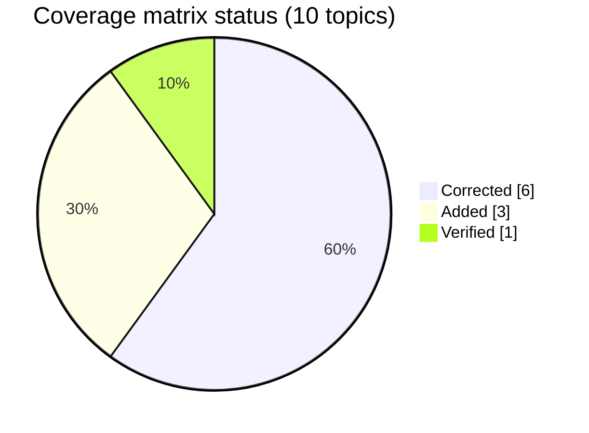

# 🔍 Documentation Audit

<!-- docs-nav -->

<a href="README.md">Hub</a> · <a href="Architecture-overview.md">Overview</a> · <a href="ARCHITECTURE.md">Deep dive</a> · <a href="backend-architecture.md">Backend</a> · <a href="frontend-architecture.md">Frontend</a> · <a href="database-architecture.md">Database</a> · <a href="authentication-architecture.md">Auth</a> · <a href="api-endpoints.md">API</a> · <a href="SECURITY.md">Security</a> · <a href="tech-stack.md">Stack</a> · <a href="configuration-and-environment.md">Config</a> · <a href="setup.md">Setup</a> · <a href="observability.md">Observability</a> · <a href="testing.md">Testing</a> · <a href="troubleshooting.md">Troubleshooting</a>

> Records the differences between the old docs and the code as implemented in the repository. **The repo code wins when there is a mismatch.**

## 📊 Audit at a glance

| Legend | Meaning |
| --- | --- |
| ✏️ Corrected | The old claim was wrong or outdated and has been fixed |
| 🆕 Added | The document did not exist before |
| ✅ Verified | Checked against the code and found accurate |

## 🗂️ Coverage matrix

| Topic | File | Status |
| --- | --- | --- |
| Documentation map | [README.md](README.md) | ✏️ Corrected |
| Architecture overview | [Architecture-overview.md](Architecture-overview.md) | 🆕 Added and verified |
| Module dependency graph | [backend/pom.xml](../backend/pom.xml) | ✅ Verified |
| Security policy | [SECURITY.md](SECURITY.md) | ✏️ Corrected to code facts |
| Setup and runtime | [setup.md](setup.md) | ✏️ Corrected |
| API inventory | [api-endpoints.md](api-endpoints.md) | ✏️ Corrected |
| Authentication flow | [authentication-architecture.md](authentication-architecture.md) | ✏️ Corrected |
| DB relationships | [database-architecture.md](database-architecture.md) | ✏️ Corrected |
| Testing verification | [testing.md](testing.md) | 🆕 Added |
| Changelog | [CHANGELOG.md](CHANGELOG.md) | 🆕 Added |

## ✏️ Corrections made

### 1. Module dependencies: `backend/pom.xml` and child POMs

| | |
| --- | --- |
| ❌ **Old claim** | One doc claimed the API depends only on common or that workers are the API dependency. |
| ✅ **Corrected claim** | The real graph is: `amrutam-api -> amrutam-common` and `amrutam-api -> amrutam-workers`; `amrutam-workers -> amrutam-common`. There is no reverse compile dependency from workers to API. |
| 📎 **Evidence** | [backend/pom.xml](../backend/pom.xml), [backend/amrutam-api/pom.xml](../backend/amrutam-api/pom.xml), [backend/amrutam-workers/pom.xml](../backend/amrutam-workers/pom.xml) |

### 2. Cross-links in `SECURITY.md`

| | |
| --- | --- |
| ❌ **Old claim** | Links pointed to an architecture file that was not the canonical path or had stale naming. |
| ✅ **Corrected claim** | Cross-links were normalized to the current docs layout and canonical naming. |
| 📎 **Evidence** | [SECURITY.md](SECURITY.md), [README.md](README.md) |

### 3. Relationships in `database-architecture.md`

| | |
| --- | --- |
| ❌ **Old claim** | Several relationship statements were simplified and did not reflect the actual schema. |
| ✅ **Corrected claim** | `doctors` to `availability_slots` is one-to-many; `users` to `doctors` is one-to-one via `user_id`; `consultations` owns `payments` and `prescriptions`; `idempotency_keys` is unique on `(user_id, method, path, body_hash)`. |
| 📎 **Evidence** | [backend/amrutam-api/src/main/resources/schema.sql](../backend/amrutam-api/src/main/resources/schema.sql) |

### 4. MFA and auth claims: `authentication-architecture.md` and `SECURITY.md`

| | |
| --- | --- |
| ❌ **Old claim** | MFA and auth claims were discussed as if fully implemented in a certain way. |
| ✅ **Corrected claim** | The code shows MFA flow exists but verification is a stub in the current implementation; the login flow may return a challenge structure and verification only accepts a 6-digit code in the current app semantics. |
| 📎 **Evidence** | [AuthController.java](../backend/amrutam-api/src/main/java/com/amrutam/api/controller/AuthController.java), [AuthContext.tsx](../frontend/src/context/AuthContext.tsx) |

### 5. Endpoints: `api-endpoints.md`

| | |
| --- | --- |
| ❌ **Old claim** | Some endpoint paths and methods were not fully confirmed. |
| ✅ **Corrected claim** | The admin analytics endpoints are POST with JSON bodies, not GET; capture payment path is under `/api/v1/payments/{paymentId}/capture`; no dedicated logout endpoint exists in the current backend controllers. |
| 📎 **Evidence** | [AdminAnalyticsController.java](../backend/amrutam-api/src/main/java/com/amrutam/api/controller/AdminAnalyticsController.java), [ConsultationsController.java](../backend/amrutam-api/src/main/java/com/amrutam/api/controller/ConsultationsController.java), [AuthController.java](../backend/amrutam-api/src/main/java/com/amrutam/api/controller/AuthController.java) |

### 6. Frontend routing and screenshots

| | |
| --- | --- |
| ❌ **Old claim** | Some docs implied the app had more complete routing or screenshot coverage than it did. |
| ✅ **Corrected claim** | Frontend routes are explicitly defined in `frontend/src/main.tsx`; no real page screenshots were produced in this environment, so that part remains unverified and not claimed as fact. |
| 📎 **Evidence** | [main.tsx](../frontend/src/main.tsx), [ProtectedRoute.tsx](../frontend/src/components/ProtectedRoute.tsx) |

### 7. Runtime documentation

| | |
| --- | --- |
| ❌ **Old claim** | Some docs claimed direct local host-only operations without container references. |
| ✅ **Corrected claim** | Runtime config uses Docker Compose service names and containerized startup; the verified stack was `postgres`, `redis`, `api`, `workers` via Compose. |
| 📎 **Evidence** | [docker-compose.yml](../docker-compose.yml), [start.sh](../start.sh), [nginx.conf](../frontend/nginx.conf) |

### 8. Navigation between README files

| | |
| --- | --- |
| ❌ **Old claim** | There was a mismatch in naming and navigation between overview docs and architecture docs. |
| ✅ **Corrected claim** | Canonical navigation now points to `architecture-overview.md` and `ARCHITECTURE.md` with consistent relative links. |
| 📎 **Evidence** | [../README.md](../README.md), [README.md](README.md) |

## ⏳ Notable unverified or blocked items

These remain explicitly unverified and are recorded as such, rather than assumed:

| Item | Status |
| --- | --- |
| Browser screenshots for every frontend page under `docs/images/frontend/` | Not captured |
| Full frontend page visual validation in a real browser session | Not performed |
| Production deployment, backup and DR runbooks | Future operational addition |

## 📦 Why some legacy files were kept

The older names such as `Architecture-overview.md` were retained as legacy aliases and not deleted, because the rule requires preserving existing documentation unless a deletion is explicitly justified and recorded. The canonical links now point to the verified, consistent naming scheme.

<!-- docs-footer -->
---

⬅️ <a href="CHANGELOG.md">Changelog</a> · 🏠 <a href="README.md">Docs hub</a>
