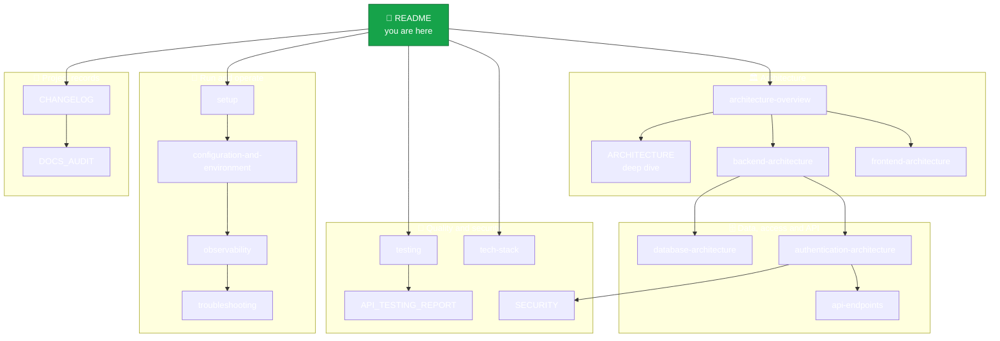

<div align="center">

# 🌿 Amrutam Documentation

**Telemedicine platform · Java 21 · Spring Boot 3.3 · PostgreSQL 16 · Redis 7 · React 18**


*The canonical documentation set for the backend, frontend, infrastructure, testing and runtime behaviour.*

</div>

---

## 🧭 Pick your path

| I want to… | Start here |
| --- | --- |
| Run the project in 2 minutes | [🚀 setup.md](setup.md) |
| Understand the big picture | [🏛️ Architecture-overview.md](Architecture-overview.md) |
| See how a booking works end to end | [🧩 ARCHITECTURE.md](ARCHITECTURE.md) |
| Understand the tables and relations | [🗄️ database-architecture.md](database-architecture.md) |
| Know who can call what | [🔐 authentication-architecture.md](authentication-architecture.md) |
| Find an endpoint | [🔌 api-endpoints.md](api-endpoints.md) |
| See what was tested and how | [🧪 testing.md](testing.md) |
| Review security posture | [🛡️ SECURITY.md](SECURITY.md) |
| Contribute safely | [🤝 CONTRIBUTING.md](CONTRIBUTING.md) |
| Fix something that broke | [🩺 troubleshooting.md](troubleshooting.md) |

## 🗺️ Documentation map



## 📚 All documents

### 🏛️ Architecture

| Document | What you will learn |
| --- | --- |
| [Architecture-overview.md](Architecture-overview.md) | Concise end-to-end picture: layers, modules, request flow |
| [ARCHITECTURE.md](ARCHITECTURE.md) | Booking saga, compensation matrix, ER model, async jobs, caching, DR |
| [backend-architecture.md](backend-architecture.md) | The three Maven modules, dependency rules, runtime behaviour |
| [frontend-architecture.md](frontend-architecture.md) | React app structure, routes, role-based guards |
| [database-architecture.md](database-architecture.md) | PostgreSQL schema ownership, entity groups, Redis role |

### 🔐 Access and API

| Document | What you will learn |
| --- | --- |
| [authentication-architecture.md](authentication-architecture.md) | JWT, roles, MFA, authorization layers |
| [api-endpoints.md](api-endpoints.md) | REST + GraphQL surface grouped by domain |
| [SECURITY.md](SECURITY.md) | Threat model, OWASP Top-10 mapping, key rotation, MFA status |

### 🚀 Run and operate

| Document | What you will learn |
| --- | --- |
| [setup.md](setup.md) | Docker-first startup, ports, useful URLs |
| [configuration-and-environment.md](configuration-and-environment.md) | Environment variable names and Spring configuration sources |
| [observability.md](observability.md) | Health checks, metrics, logs and operational guidance |
| [troubleshooting.md](troubleshooting.md) | Symptoms, checks and validation commands |
| [tech-stack.md](tech-stack.md) | Every technology, and why it is there |

### 🧪 Quality

| Document | What you will learn |
| --- | --- |
| [testing.md](testing.md) | Verified commands, live evidence and test run status |
| [API_TESTING_REPORT.md](API_TESTING_REPORT.md) | Postman and k6 evidence with screenshots |

### 📝 Project records

| Document | What you will learn |
| --- | --- |
| [CHANGELOG.md](CHANGELOG.md) | Recent documentation updates and repository state |
| [DOCS_AUDIT.md](DOCS_AUDIT.md) | What was corrected against the code, and what remains open |

## 🎯 Documentation coverage

| Layer | Documents | Status |
| --- | --- | --- |
| Architecture | overview, deep dive, backend, frontend, database | ✅ Documented |
| Access and API | authentication, api-endpoints, SECURITY | ✅ Documented |
| Run and operate | setup, configuration, observability, troubleshooting, tech-stack | ✅ Documented |
| Testing | testing, API_TESTING_REPORT | ✅ Documented |
| Frontend page screenshots | `docs/images/frontend/` | ⏳ Pending |
| Deployment, backup and DR runbooks | production operations | ⏳ Future addition |

## 📖 Recommended reading order

```text
 1 ─▶ architecture-overview        the map
 2 ─▶ backend-architecture         modules
 3 ─▶ frontend-architecture        UI
 4 ─▶ database-architecture        data
 5 ─▶ authentication-architecture  access
 6 ─▶ api-endpoints                surface
 7 ─▶ SECURITY                     hardening
 8 ─▶ setup                        run it
 9 ─▶ testing                      prove it
```

> [!NOTE]
> Docs are split by concern so nothing is duplicated. Repository-level context lives in [../README.md](../README.md); this folder holds the deep design and operational detail.

> [!TIP]
> On case-insensitive filesystems (Windows/macOS) `architecture.md` and `ARCHITECTURE.md` would collide, so the concise overview is named `Architecture-overview.md` to match the existing file on disk and avoid broken case-sensitive links.
