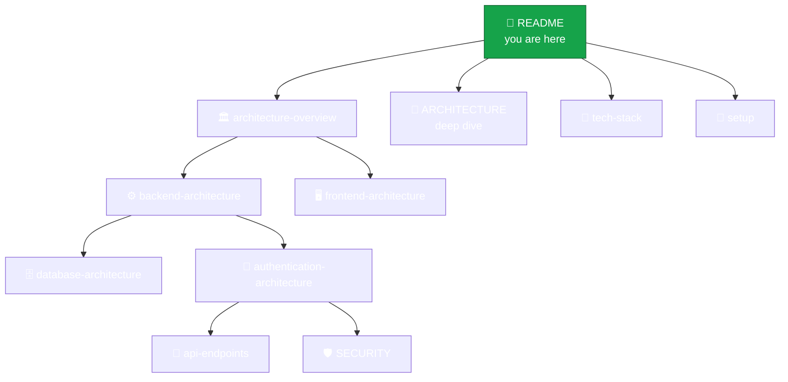

<div align="center">

# 🌿 Amrutam Documentation

**Telemedicine platform · Java 21 · Spring Boot 3.3 · PostgreSQL 16 · Redis 7 · React 18**


*The canonical documentation set for the backend, frontend, infrastructure and runtime behaviour.*

</div>

---

## 🧭 Pick your path

| I want to… | Start here |
| --- | --- |
| Run the project in 2 minutes | [⚙️ setup.md](setup.md) |
| Understand the big picture | [🏛️ architecture-overview.md](architecture-overview.md) |
| See how a booking works end to end | [🧩 ARCHITECTURE.md](ARCHITECTURE.md) |
| Understand the tables and relations | [🗄️ database-architecture.md](database-architecture.md) |
| Know who can call what | [🔐 authentication-architecture.md](authentication-architecture.md) |
| Review security posture | [🛡️ SECURITY.md](SECURITY.md) |

## 🗺️ Documentation map



## 📚 All documents

| Document | What you will learn |
| --- | --- |
| [architecture-overview.md](architecture-overview.md) | Concise end-to-end picture: layers, modules, request flow |
| [ARCHITECTURE.md](ARCHITECTURE.md) | Booking saga, compensation matrix, ER model, async jobs, caching, DR |
| [backend-architecture.md](backend-architecture.md) | The three Maven modules, dependency rules, runtime behaviour |
| [frontend-architecture.md](frontend-architecture.md) | React app structure, routes, role-based guards |
| [database-architecture.md](database-architecture.md) | PostgreSQL schema ownership, entity groups, Redis role |
| [authentication-architecture.md](authentication-architecture.md) | JWT, roles, MFA, authorization layers |
| [api-endpoints.md](api-endpoints.md) | REST + GraphQL surface grouped by role |
| [tech-stack.md](tech-stack.md) | Every technology, and why it is there |
| [SECURITY.md](SECURITY.md) | Threat model, OWASP Top-10 mapping, key rotation, MFA status |
| [setup.md](setup.md) | Docker-first startup, ports, useful URLs |

## 📖 Recommended reading order

```text
 1 ─▶ architecture-overview      (the map)
 2 ─▶ backend-architecture       (modules)
 3 ─▶ frontend-architecture      (UI)
 4 ─▶ database-architecture      (data)
 5 ─▶ authentication-architecture(access)
 6 ─▶ api-endpoints              (surface)
 7 ─▶ SECURITY                   (hardening)
 8 ─▶ setup                      (run it)
```

> [!NOTE]
> Docs are split by concern so nothing is duplicated. Repository-level context lives in [../README.md](../README.md); this folder holds the deep design and operational detail.

> [!TIP]
> On case-insensitive filesystems (Windows/macOS) `architecture.md` and `ARCHITECTURE.md` would collide, so the concise overview is named `architecture-overview.md`.