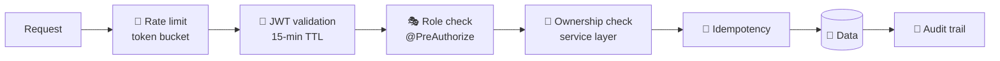
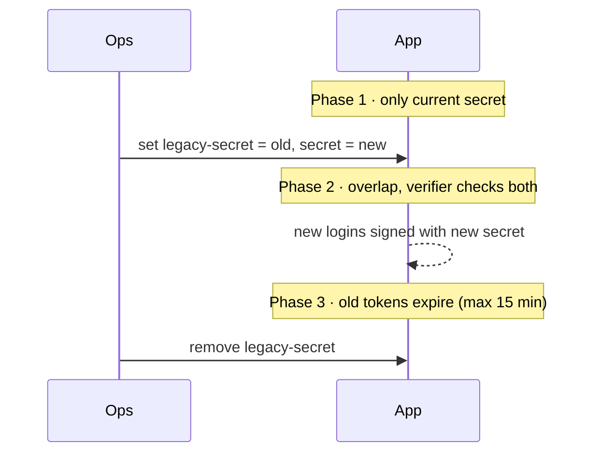

# 🛡️ Amrutam Security

> Threat model · OWASP Top-10 mapping · key rotation · MFA notes

**Contents:** [1 Threat model](#1--threat-model) · [2 OWASP](#2--owasp-top-10-mapping) · [3 Encryption](#3--encryption-at-rest--in-transit) · [4 Key rotation](#4--key-rotation-jwt-hmac-secret) · [5 MFA](#5--mfa--totp)

## 🧅 Defence in depth

## 1. 🎯 Threat model

| Asset | Threat | Mitigation |
| --- | --- | --- |
| Patient data | Unauthenticated access | JWT bearer auth (15-min TTL); `/api/v1/**` needs a valid token; `/me` returns 401 without one |
| Patient data | IDOR (reading another user's consultation) | `@PreAuthorize` + service ownership checks against the validated claim `userId`, never a spoofable principal name |
| Payments | Duplicate billing | Idempotency natural key `(userId, method, path, bodyHash)`; unique `payments.idempotency_key`; `X-Idempotency-Key` header makes replays stable |
| Doctor availability | Double-booking | Atomic `UPDATE … WHERE status='AVAILABLE'` (one winner); 409 on race; 15-min lock; saga reconciler cleans stuck rows |
| Admin analytics | Privilege escalation | `hasRole('ADMIN')` on `/api/v1/admin/**`; separate OpenAPI "admin" group |
| JWT secret | Reuse / leakage | Dev placeholder only; prod requires `JWT_SECRET`; two-secret overlap rotation; short TTL limits blast radius |
| Audit trail | Tampering | Dedicated AUDIT logback appender (rolling file, 30-day retention) + `AuditWorker` draining the Redis audit stream |

## 2. 🔟 OWASP Top-10 mapping

| ID | Category | Mitigation in code |
| --- | --- | --- |
| A01 | Broken Access Control | `@PreAuthorize`, service ownership checks, role-gated admin endpoints |
| A02 | Cryptographic Failures | BCrypt passwords; HMAC-SHA256 JWT (auth0 java-jwt); no plaintext PII in logs; AES at-rest field encryption noted for future |
| A03 | Injection | JPA parameterized queries; workers use bind variables; no string-built SQL |
| A04 | Insecure Design | Saga with explicit compensation matrix; exactly-once slot lock; documented idempotency semantics |
| A05 | Security Misconfiguration | Stateless JWT; CSRF deliberately disabled (bearer auth); prod: forward-headers framework, minimal actuator (health + prometheus), INFO logging |
| A06 | Vulnerable Components | OWASP dependency-check in CI; pinned BOM versions; quarterly re-scan |
| A07 | Auth Failures | 15-min TTL + refresh; MFA (TOTP) in login flow; disabled accounts rejected |
| A08 | Software and Data Integrity | Idempotency + `saga_steps` trace; workers reconcile stuck sagas |
| A09 | Logging Failures | MDC `traceId` on every response and log line; AUDIT appender; durable `audit_logs` table |
| A10 | SSRF / XXE | No user-controlled outbound URLs; JSON-only API |

**Additional:** 🚦 `RateLimitFilter` per-endpoint token bucket (`amrutam.ratelimit.default-qps/burst` + overrides) · 🔒 gateway tokens held only in memory during the request · payment idempotency keys are opaque.

## 3. 🔒 Encryption at rest / in transit

| Scope | Status |
| --- | --- |
| In transit | TLS terminated at the platform proxy; prod sets `server.forward-headers-strategy: framework` |
| Postgres at rest | Use `sslmode=require` in prod (documented, **not yet enforced**) |
| Redis | Should run behind TLS in prod |

## 4. 🔑 Key rotation (JWT HMAC secret)

Config: `amrutam.jwt.secret` (current) and `amrutam.jwt.legacy-secret` (previous). Existing tokens stay valid until expiry; the 15-min TTL plus refresh endpoint keep the window short.

## 5. 📲 MFA / TOTP

- When `users.mfa_enabled` is `TRUE`, `/auth/login` returns an `MfaChallengeDto` (secret + `otpauth://` URI) instead of a token; `/auth/mfa/verify` then issues the token.

> [!CAUTION]
> **Status: STUB.** TOTP verification currently accepts any well-formed 6-digit code until the RFC 6238 integration lands. The secret column and provisioning URI are already wired. Do not rely on MFA in production until this follow-up is done.