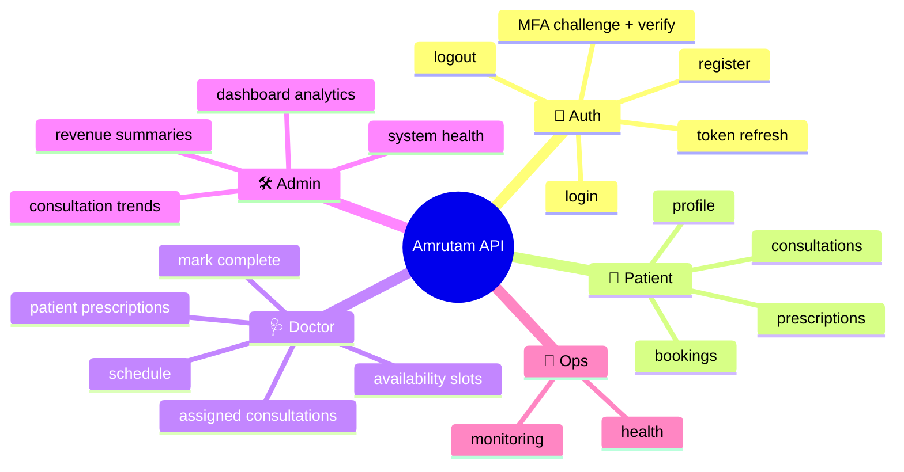
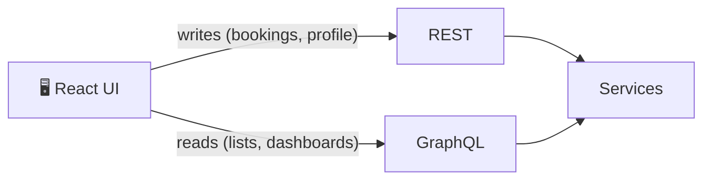

# 🔌 API Endpoints

> The API surface is organized around resource domains with consistent authorization rules. Swagger UI is the live source of truth: `http://localhost:8080/swagger-ui.html`.

## 📐 1. Conventions

| Convention | Detail |
| --- | --- |
| 🌐 REST | Transactional actions |
| 🔮 GraphQL | Read-heavy, schema-driven queries |
| 🪪 JWT | Bearer protection on `/api/v1/**` |
| 🎭 Roles | Role checks on privileged endpoints |
| 🔁 Idempotency | Safe repeated writes (`X-Idempotency-Key`) |

## 🗺️ 2. Surface at a glance

## 🔐 3. Authentication endpoints

| Operation | Purpose |
| --- | --- |
| Login | Validate credentials, issue JWT (or MFA challenge) |
| Registration | Create an account |
| Logout | End session |
| MFA challenge + verification | Two-step login |
| Token refresh | Extend session without re-login |

## 🧑 4. Patient operations

| Operation | Notes |
| --- | --- |
| Fetch profile | Own profile only |
| View consultations | Ownership enforced |
| Create / confirm bookings | Runs the [booking saga](ARCHITECTURE.md#4--booking-saga) |
| Read prescriptions | Own prescriptions |
| Update profile | Ownership enforced |

## 🩺 5. Doctor operations

| Operation | Notes |
| --- | --- |
| Create availability slots | Slots start `AVAILABLE` |
| View assigned consultations | Only own consultations |
| Mark consultation completed | `PAID → COMPLETED` |
| Read patient prescriptions | Linked to their consultations |
| Check schedule | Appointment schedule data |

## 🛠️ 6. Admin operations

All under `/api/v1/admin/**`, guarded by `@PreAuthorize("hasRole('ADMIN')")`.

| Operation | Notes |
| --- | --- |
| Dashboard analytics | Cached 5 min |
| Revenue summaries | Financial overview |
| Consultation trends | Trend reporting |
| System health | Pending and dead job counts |

## 🔮 7. GraphQL usage

GraphQL exposes domain queries in a schema-driven way so the frontend fetches only selected fields, avoiding over-fetching and a sprawl of one-off REST endpoints.

## 🩻 8. Operational endpoints

Health and monitoring endpoints (Actuator) support diagnostics. In prod, exposure is minimal (health + prometheus).

> [!NOTE]
> Validate the final endpoint inventory against the running API; this file describes architectural intent rather than duplicating the codebase.