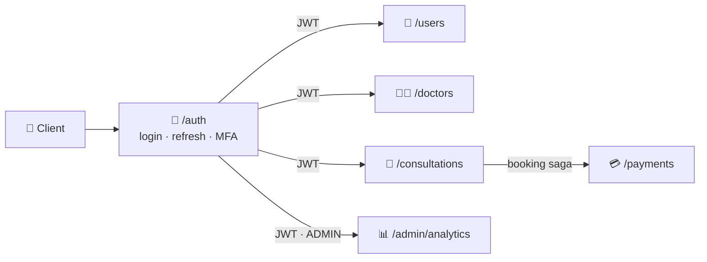
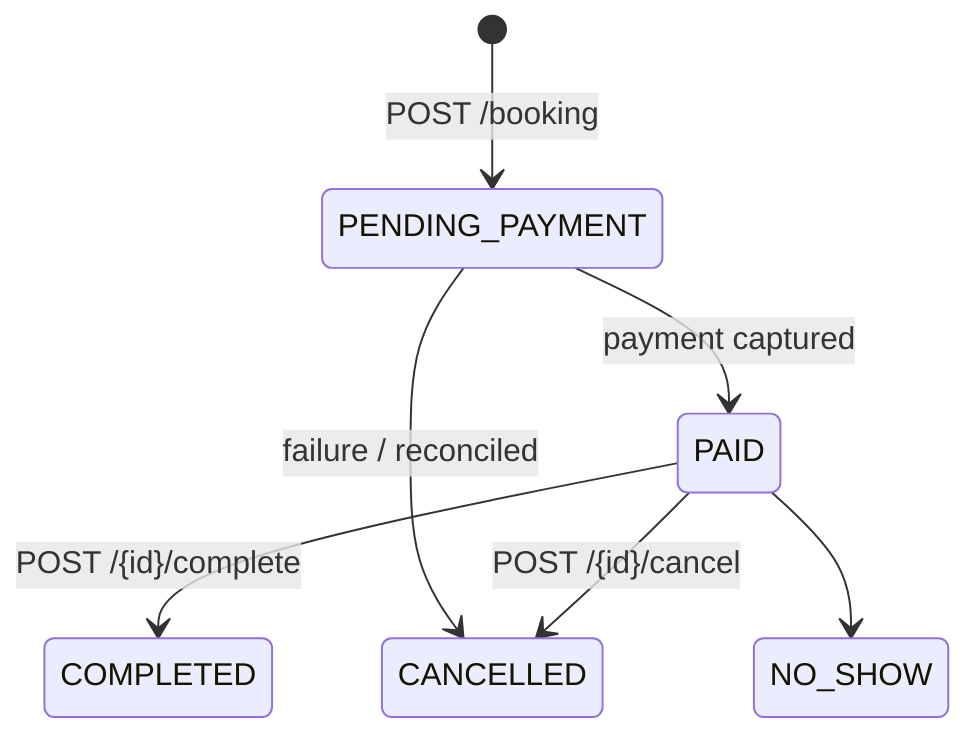
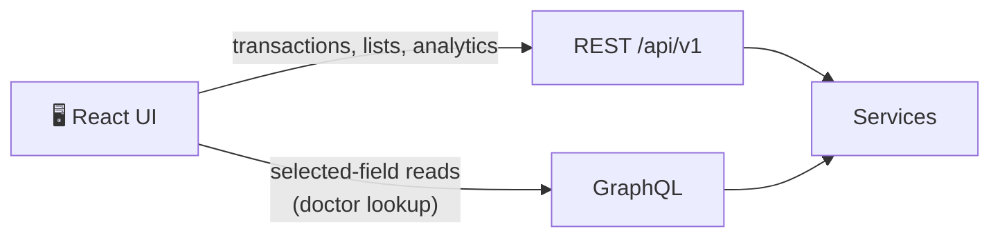

# 🔌 API Endpoints

<!-- docs-nav -->
<p align="center"><sub><a href="README.md">Hub</a> · <a href="Architecture-overview.md">Overview</a> · <a href="ARCHITECTURE.md">Deep dive</a> · <a href="backend-architecture.md">Backend</a> · <a href="frontend-architecture.md">Frontend</a> · <a href="database-architecture.md">Database</a> · <a href="authentication-architecture.md">Auth</a> · <b>API</b> · <a href="SECURITY.md">Security</a> · <a href="tech-stack.md">Stack</a> · <a href="configuration-and-environment.md">Config</a> · <a href="setup.md">Setup</a> · <a href="observability.md">Observability</a> · <a href="testing.md">Testing</a> · <a href="troubleshooting.md">Troubleshooting</a></sub></p>


> The API surface is organised around resource domains with consistent authorization rules. **Swagger UI is the live source of truth:** `http://localhost:8080/swagger-ui.html`. This page is intentionally a historical snapshot of the observed API surface from a real Postman run, not a replacement for the live controller contract.

**Contents:** [1 Conventions](#-1-conventions) · [2 Surface](#-2-surface-at-a-glance) · [3 Auth](#-3-authentication) · [4 Users](#-4-users) · [5 Doctors](#-5-doctors) · [6 Consultations](#-6-consultations-and-prescriptions) · [7 Payments](#-7-payments) · [8 Admin](#-8-admin-analytics) · [9 GraphQL](#-9-graphql-usage) · [10 Operational](#-10-operational-endpoints) · [11 Known gaps](#-11-known-gaps)

> [!IMPORTANT]
> This page is a **snapshot from a historical run**. The status columns reflect a single Postman execution captured in [API_TESTING_REPORT.md](API_TESTING_REPORT.md). They are evidence, not the current canonical contract. The current canonical API contract is defined by the controllers in [AuthController.java](../backend/amrutam-api/src/main/java/com/amrutam/api/controller/AuthController.java), [DoctorsController.java](../backend/amrutam-api/src/main/java/com/amrutam/api/controller/DoctorsController.java), and [UsersController.java](../backend/amrutam-api/src/main/java/com/amrutam/api/controller/UsersController.java).

> [!NOTE]
> The **Postman run** column shows the HTTP status from the run at 23:56:10, and it does not establish a final status for later code changes. The screenshots do not show response bodies, so the cause of a 4xx or 5xx is not established. `{id}` marks a path variable; several requests in that run had it empty.

## 📐 1. Conventions

> [!TIP]
> The tables below mix two different things: the live controller contract and the historical Postman evidence. Use the controller files for current source-of-truth paths and methods; use the “Postman run” column only as evidence of what happened in one verification run.

| Convention | Detail |
| --- | --- |
| 🌐 REST | Transactional actions and most list reads, under `/api/v1/**` |
| 🔮 GraphQL | Schema-driven reads where selected fields are needed (see [section 9](#-9-graphql-usage)) |
| 🪪 JWT | `Authorization: Bearer <token>` on `/api/v1/**`; short-lived (15 min) with a refresh endpoint |
| 🎭 Roles | `PATIENT`, `DOCTOR`, `ADMIN`; admin endpoints are gated by `hasRole('ADMIN')` |
| 🔁 Idempotency | Safe repeated writes; an explicit `X-Idempotency-Key` header makes replays stable |
| 📄 Pagination | `page` (0-based) and `size` query parameters; page responses carry `content` and `totalElements` |
| ❗ Errors | JSON error body with `code` and `message`; a trace id is attached to every response envelope |
| 🚦 Rate limiting | Per-endpoint token bucket in the shared kernel |

## 🗺️ 2. Surface at a glance

```text
/actuator/health                                   🩻 health (public)
/swagger-ui.html                                   📘 live API docs
/api/v1
├── auth
│   ├── POST register                              🔐 patient self-signup
│   ├── POST login                                 🔐 token, or MFA challenge
│   ├── POST refresh
│   ├── GET  me
│   └── POST mfa/verify
├── users
│   ├── GET   me
│   ├── GET   ?page&size
│   └── PATCH {id}/profile
├── doctors
│   ├── GET   ?q&page&size                         🔎 search
│   ├── POST  (create)
│   ├── GET   {id}
│   ├── GET   {id}/availability?from&to&page&size
│   └── POST  {id}/availability                    🗓️ create slot
├── consultations
│   ├── GET   ?page&size
│   ├── POST  booking                              💳 runs the booking saga
│   ├── GET   {id}
│   ├── POST  {id}/cancel
│   ├── POST  {id}/complete
│   └── GET   {id}/prescription
├── payments
│   ├── POST  {id}/capture                         💳 capture a payment
│   └── POST  {id}/refund
└── admin/analytics                                🛠️ ADMIN only, all POST
    ├── POST daily-consultations                   body: { date }
    ├── POST revenue-summary                       body: { from, to }
    └── POST health                                body: { }
```



## 🔐 3. Authentication

Base path `/api/v1/auth`.

| Method | Path | Purpose | Postman run |
| --- | --- | --- | --- |
| POST | `/auth/register` | Create a patient account | ⚠️ 409 |
| POST | `/auth/login` | Validate credentials, issue a JWT (or an MFA challenge) | ✅ 200 |
| POST | `/auth/refresh` | Extend a session without logging in again | ✅ 200 |
| GET | `/auth/me` | Profile of the signed-in user | ✅ 200 |
| POST | `/auth/mfa/verify` | Second step of a two-step login | ⚠️ 401 |

> [!WARNING]
> TOTP verification is currently a stub that accepts any well-formed 6-digit code. See [SECURITY.md](SECURITY.md#5--mfa--totp). There is no dedicated logout endpoint in the current backend controllers.

## 👤 4. Users

| Method | Path | Purpose | Notes | Postman run |
| --- | --- | --- | --- | --- |
| GET | `/users/me` | Current user | Own record | ✅ 200 |
| GET | `/users?page=0&size=20` | List users | Paged | ✅ 200 |
| PATCH | `/users/{id}/profile` | Update a profile | Ownership enforced | ✅ 200 |

## 🧑‍⚕️ 5. Doctors

| Method | Path | Purpose | Notes | Postman run |
| --- | --- | --- | --- | --- |
| GET | `/doctors?q=&page=0&size=10` | Search doctors | `q` matches name or specialty | ⚠️ 401 |
| POST | `/doctors` | Create a doctor | Links a doctor row to a user | ⚠️ 409 |
| GET | `/doctors/{id}` | Doctor details | | ⚠️ 401 |
| GET | `/doctors/{id}/availability?from=&to=&page=&size=` | Availability slots in a time range | ISO-8601 timestamps | ⚠️ 401 |
| POST | `/doctors/{id}/availability` | Create a slot | New slots start `AVAILABLE` | ⚠️ 401 |

## 📅 6. Consultations and prescriptions

| Method | Path | Purpose | Notes | Postman run |
| --- | --- | --- | --- | --- |
| GET | `/consultations?page=0&size=20` | List consultations | Scoped to the caller | ✅ 200 |
| POST | `/consultations/booking` | Book a consultation | Runs the [booking saga](ARCHITECTURE.md#4--booking-saga); idempotent | ⚠️ 400 |
| GET | `/consultations/{id}` | One consultation | Ownership enforced | ❌ 500 |
| POST | `/consultations/{id}/cancel` | Cancel | Not for `CANCELLED` or `COMPLETED` | ⚠️ 401 |
| POST | `/consultations/{id}/complete` | Mark completed | `PAID → COMPLETED` | not captured |
| GET | `/consultations/{id}/prescription` | Read the prescription | Read-only; a miss is returned as an error | not in run |



## 💳 7. Payments

| Method | Path | Purpose | Postman run |
| --- | --- | --- | --- |
| POST | `/payments/{id}/capture` | Capture a payment | not captured |
| POST | `/payments/{id}/refund` | Refund a payment | ⚠️ 401 |

## 📊 8. Admin analytics

All under `/api/v1/admin/analytics`, guarded by `@PreAuthorize("hasRole('ADMIN')")`. **These are POST requests with a JSON body, not GET.**

| Method | Path | Body | Notes | Postman run |
| --- | --- | --- | --- | --- |
| POST | `/admin/analytics/daily-consultations` | `{ "date": "YYYY-MM-DD" }` | Per-day counts, including per-doctor | ✅ 200 |
| POST | `/admin/analytics/revenue-summary` | `{ "from": "...", "to": "..." }` | Total captured and payment count | ✅ 200 |
| POST | `/admin/analytics/health` | `{}` | Active sessions, pending jobs, dead letters | ✅ 200 |

Analytics results are cached for 5 minutes (see [caching](ARCHITECTURE.md#7--caching)).

## 🔮 9. GraphQL usage

GraphQL exposes domain queries so a client can fetch only the fields it needs. In the current frontend it is used for the **doctor lookup** (`doctors { id userId name specialization consultationFee yearsExperience bio }`), which the doctor dashboard uses to find the doctor row linked to the signed-in user. Most list reads (doctors search, consultations) go through REST.



## 🩻 10. Operational endpoints

| Path | Purpose | Postman run |
| --- | --- | --- |
| `GET /actuator/health` | Liveness, readiness, db, redis, disk | ✅ 200 |
| `GET /swagger-ui.html` | Interactive API documentation | not in run |

In prod, Actuator exposure is minimal (health and prometheus).

## 🚧 11. Known gaps

| Gap | Effect |
| --- | --- |
| No doctor-scoped consultation listing | The doctor dashboard queries `/consultations` with a `doctorId` workaround |
| Prescription write is not exposed | Only `GET /consultations/{id}/prescription`; doctors can complete a consultation but not write a prescription from the UI |
| MFA verification is a stub | Any 6-digit code is accepted until RFC 6238 verification lands |
| Capture Payment and Complete Consultation results | Not visible in the test evidence |

> [!NOTE]
> Validate the endpoint inventory against the running API (Swagger UI) before relying on it. This page is a historical evidence snapshot of what the tests and frontend code showed, not a guaranteed current contract for future changes.

<!-- docs-footer -->
---

<p align="center">⬅️ <a href="authentication-architecture.md">Auth</a> · 🏠 <a href="README.md">Docs hub</a> · <a href="SECURITY.md">Security</a> ➡️</p>