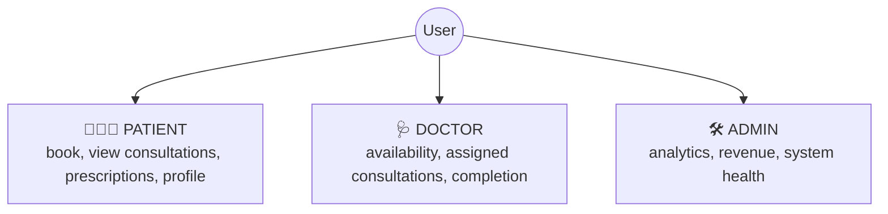
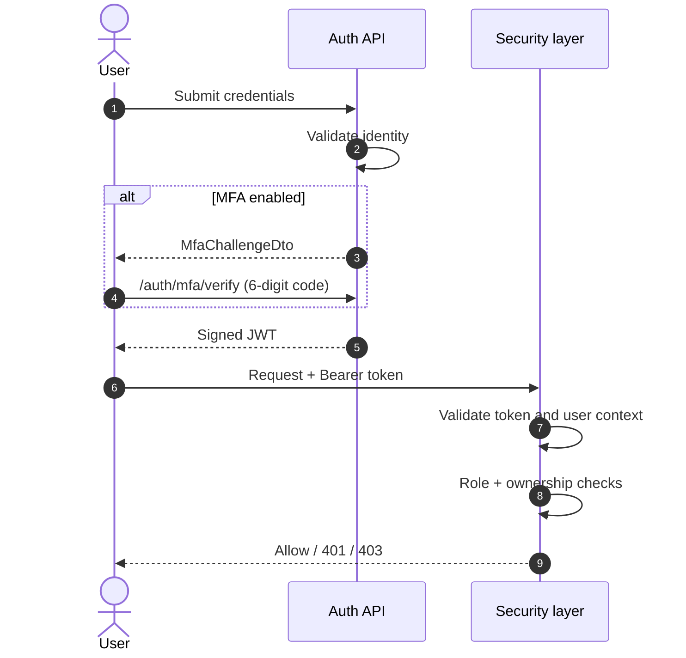
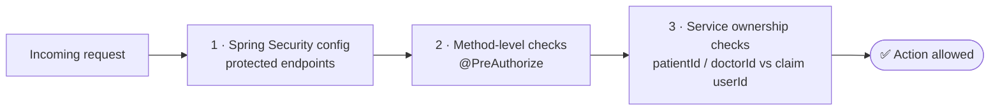

# 🔐 Authentication & Authorization

<!-- docs-nav -->

<a href="README.md">Hub</a> · <a href="Architecture-overview.md">Overview</a> · <a href="ARCHITECTURE.md">Deep dive</a> · <a href="backend-architecture.md">Backend</a> · <a href="frontend-architecture.md">Frontend</a> · <a href="database-architecture.md">Database</a> · <b>Auth</b> · <a href="api-endpoints.md">API</a> · <a href="SECURITY.md">Security</a> · <a href="tech-stack.md">Stack</a> · <a href="configuration-and-environment.md">Config</a> · <a href="setup.md">Setup</a> · <a href="observability.md">Observability</a> · <a href="testing.md">Testing</a> · <a href="troubleshooting.md">Troubleshooting</a>

> A JWT-based, role-aware security model centred on the backend API.

## 🧱 1. Security model

| Layer | Mechanism |
| --- | --- |
| 🪪 Authentication | JWT bearer tokens |
| 🎭 Authorization | Role-based access control (RBAC) |
| 🧍 Ownership | Explicit checks on user-sensitive operations |
| 🔑 Credentials | Password hashing (BCrypt) |

## 🎭 2. Roles

## 🔄 3. Authentication flow

## 🧅 4. Authorization layers

Enforcing at both framework and service layers reduces the risk of unauthorized cross-user access (IDOR).

## 📲 5. MFA support

When `users.mfa_enabled` is true, login returns a challenge instead of a token; verification then issues the final token.

> [!WARNING]
> The MFA flow is present, but the current TOTP verification is a **stub**, not a production security control. It accepts any well-formed 6-digit code until the RFC 6238 integration lands. See [SECURITY.md](SECURITY.md#5--mfa--totp).

## 🎫 6. Token security

| Setting | Notes |
| --- | --- |
| Issuer + signing config | HMAC-SHA256 |
| Expiry | Short-lived (15 min), refresh endpoint available |
| Secrets | Environment configuration, never static developer secrets |
| Validation | Request context validated before access is granted |

## 🛡️ 7. Additional protections

| Protection | Purpose |
| --- | --- |
| 🚦 Rate limiting | Abusive usage patterns |
| 🔁 Idempotency | Safe repeated requests |
| 📝 Audit logging | Operational visibility |
| 🔒 Env-based secrets | No static secrets |

## 📌 8. Summary

Bearer-token auth + role checks + ownership validation + audit capture + rate limits and idempotency safeguards: a balance of usability and protection.

<!-- docs-footer -->
---

⬅️ <a href="database-architecture.md">Database</a> · 🏠 <a href="README.md">Docs hub</a> · <a href="api-endpoints.md">API endpoints</a> ➡️
