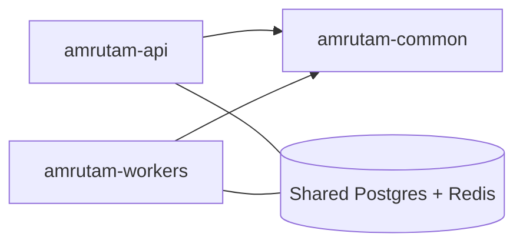

# ⚙️ Backend Architecture

<!-- docs-nav -->

<a href="README.md">Hub</a> · <a href="Architecture-overview.md">Overview</a> · <a href="ARCHITECTURE.md">Deep dive</a> · <b>Backend</b> · <a href="frontend-architecture.md">Frontend</a> · <a href="database-architecture.md">Database</a> · <a href="authentication-architecture.md">Auth</a> · <a href="api-endpoints.md">API</a> · <a href="SECURITY.md">Security</a> · <a href="tech-stack.md">Stack</a> · <a href="configuration-and-environment.md">Config</a> · <a href="setup.md">Setup</a> · <a href="observability.md">Observability</a> · <a href="testing.md">Testing</a> · <a href="troubleshooting.md">Troubleshooting</a>

> A Maven multi-module project under `../backend`: **`amrutam-common`**, **`amrutam-api`**, **`amrutam-workers`**.

## 🌳 1. Module structure

```mermaid
graph TD
    P(("backend<br/>parent POM"))
    P --> C["🧱 amrutam-common"]
    P --> A["⚙️ amrutam-api"]
    P --> W["🔄 amrutam-workers"]
    C --> c1["JWT + token validation"]
    C --> c2["Security filters"]
    C --> c3["Exceptions + API error bodies"]
    C --> c4["Idempotency primitives"]
    C --> c5["Rate limiting"]
    C --> c6["Audit abstractions"]
    C --> c7["Trace-id via MDC"]
    A --> a1["REST controllers"]
    A --> a2["GraphQL resolvers"]
    A --> a3["Services + domain logic"]
    A --> a4["Entities + repositories"]
    A --> a5["schema + init files"]
    A --> a6["Auth + authorization config"]
    A --> a7["Booking, consultation, analytics"]
    W --> w1["Notification delivery"]
    W --> w2["Stuck-state reconciliation"]
    W --> w3["Saga processing + recovery"]
    W --> w4["Audit events from Redis streams"]
```

| Module | Role | Analogy |
| --- | --- | --- |
| 🧱 common | Reusable platform concerns | The toolbox |
| ⚙️ api | Main entry point; domain processes and persistence | The front desk |
| 🔄 workers | Background automation | The night shift |

## 🔗 2. Dependency direction

API and workers share infrastructure, but workers do **not** own the entity layer.

## 🔒 3. Persistence ownership rule

> [!IMPORTANT]
> The API module is the single source of truth for data structure and schema. Workers may read and write the same database using raw SQL, but never define JPA entities or repositories. This is the critical architectural boundary.

## 🏃 4. Runtime behaviour

```mermaid
flowchart LR
    subgraph API["⚙️ API process"]
        a1["Patient workflow"]
        a2["Doctor workflow"]
        a3["Consultation booking"]
        a4["Authorization enforcement"]
        a5["Profile handling"]
        a6["Analytics + reporting"]
    end
    subgraph WK["🔄 Worker process"]
        w1["Poll for jobs"]
        w2["Run callbacks + notifications"]
        w3["Examine pending / stale states"]
        w4["Reconcile long-running sagas"]
    end
    API -- "writes PENDING jobs" --> DB[("PostgreSQL")] -- "polled by" --> WK
```

## 🎛️ 5. Configuration model

| Source | Purpose |
| --- | --- |
| `application.yml` | Shared defaults |
| `application-dev.yml` | Local development |
| `application-prod.yml` | Production hardening |
| Docker Compose env vars | Container-specific overrides |

The same code runs on local Docker and deployments with no hard-coded local configuration.

## 🔭 6. Observability

| Capability | Why it matters |
| --- | --- |
| Actuator + health endpoints | Liveness and diagnostics |
| Structured logging | Machine-parsable logs |
| Trace-id via MDC | Follow one request across log lines |
| Audit trail | Who did what, and when |

<!-- docs-footer -->
---

⬅️ <a href="ARCHITECTURE.md">Deep dive</a> · 🏠 <a href="README.md">Docs hub</a> · <a href="frontend-architecture.md">Frontend</a> ➡️
