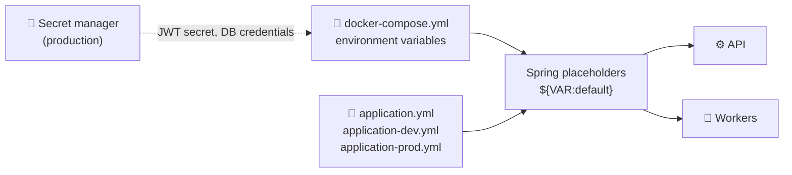

# ⚙️ Configuration and Environment Variables

<!-- docs-nav -->

<a href="README.md">Hub</a> · <a href="Architecture-overview.md">Overview</a> · <a href="ARCHITECTURE.md">Deep dive</a> · <a href="backend-architecture.md">Backend</a> · <a href="frontend-architecture.md">Frontend</a> · <a href="database-architecture.md">Database</a> · <a href="authentication-architecture.md">Auth</a> · <a href="api-endpoints.md">API</a> · <a href="SECURITY.md">Security</a> · <a href="tech-stack.md">Stack</a> · <b>Config</b> · <a href="setup.md">Setup</a> · <a href="observability.md">Observability</a> · <a href="testing.md">Testing</a> · <a href="troubleshooting.md">Troubleshooting</a>

> Lists the runtime configuration **names** used by the project. It intentionally contains no secrets and no sample credentials.

## 🧭 How configuration reaches the app

## 📁 Configuration sources

| Source | Role |
| --- | --- |
| [docker-compose.yml](../docker-compose.yml) | Container environment variables |
| [application.yml](../backend/amrutam-api/src/main/resources/application.yml) | Shared defaults |
| [application-dev.yml](../backend/amrutam-api/src/main/resources/application-dev.yml) | Local development profile |
| [application-prod.yml](../backend/amrutam-api/src/main/resources/application-prod.yml) | Production profile |

## 🔧 Environment variables

### 🐘 Database and Redis (API and workers)

| Name | Purpose |
| --- | --- |
| `DB_URL` | JDBC URL for PostgreSQL |
| `DB_JDBC_URL` | JDBC connection string override |
| `DB_HOST` | PostgreSQL host |
| `DB_PORT` | PostgreSQL port |
| `DB_NAME` | PostgreSQL database name |
| `DB_USER` | Database login |
| `DB_PASSWORD` | Database password |
| `REDIS_HOST` | Redis host |
| `REDIS_PORT` | Redis port |

### 🚦 Runtime mode

| Name | Used by | Purpose |
| --- | --- | --- |
| `SPRING_PROFILES_ACTIVE` | API and workers | Spring profile selection |
| `AMRUTAM_ROLE` | API and workers | Role-specific startup mode |
| `AMRUTAM_SQL_INIT` | API | Whether schema/data SQL initializes on startup |
| `AMRUTAM_WORKERS_ENABLED` | Workers | Enables worker runtime behaviour |

### 🔐 JWT and security

| Name | Used by | Purpose |
| --- | --- | --- |
| `JWT_SECRET` | API | HMAC signing key |
| `AMRUTAM_JWT_SECRET` | Config consumers | Alternate naming if used by a deployment layer |

### 🐳 PostgreSQL container

| Name | Purpose |
| --- | --- |
| `POSTGRES_DB` | Database name |
| `POSTGRES_USER` | Database user |
| `POSTGRES_PASSWORD` | Database password |

## 🧩 Defaults in the Spring configuration

The app reads values using defaulted placeholders:

| Placeholder | Default |
| --- | --- |
| `${DB_HOST:postgres}` | `postgres` |
| `${DB_PORT:5432}` | `5432` |
| `${DB_NAME:amrutam}` | `amrutam` |
| `${DB_USER:amrutam}` | `amrutam` |
| `${DB_PASSWORD:amrutam}` | `amrutam` |
| `${REDIS_HOST:redis}` | `redis` |
| `${REDIS_PORT:6379}` | `6379` |
| `${AMRUTAM_SQL_INIT:always}` | `always` |

> [!WARNING]
> The database password default above is a development convenience. Never rely on it outside local development.

> [!IMPORTANT]
> The project keeps secrets out of source control. In production, values such as the JWT secret and database credentials must be supplied by the deployment environment or a secret manager.

## 🔗 Related docs

[setup.md](setup.md) · [SECURITY.md](SECURITY.md) · [backend-architecture.md](backend-architecture.md)

<!-- docs-footer -->
---

⬅️ <a href="tech-stack.md">Tech stack</a> · 🏠 <a href="README.md">Docs hub</a> · <a href="setup.md">Setup</a> ➡️
