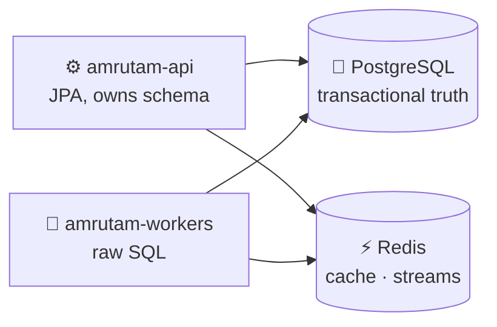
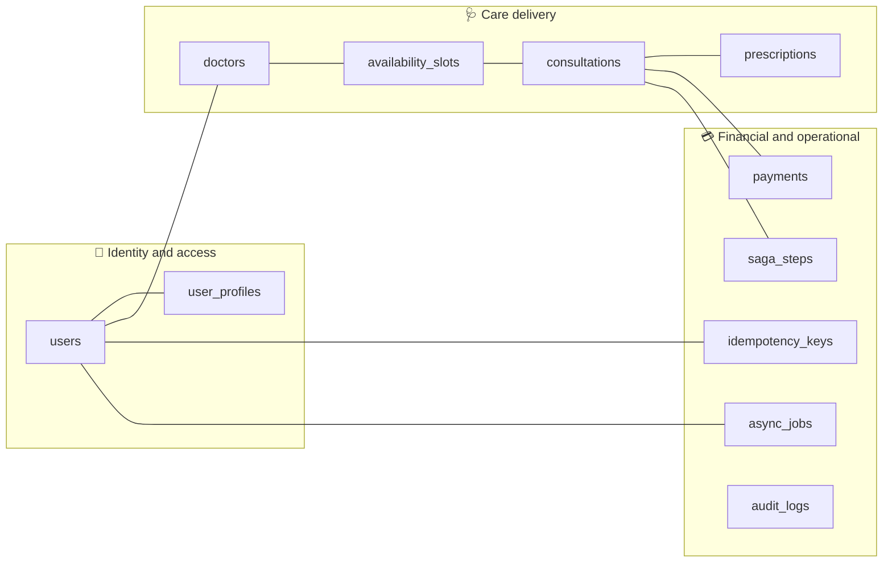
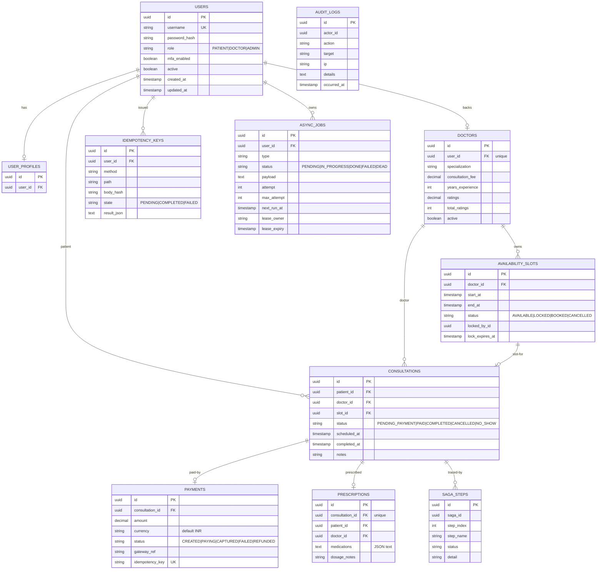
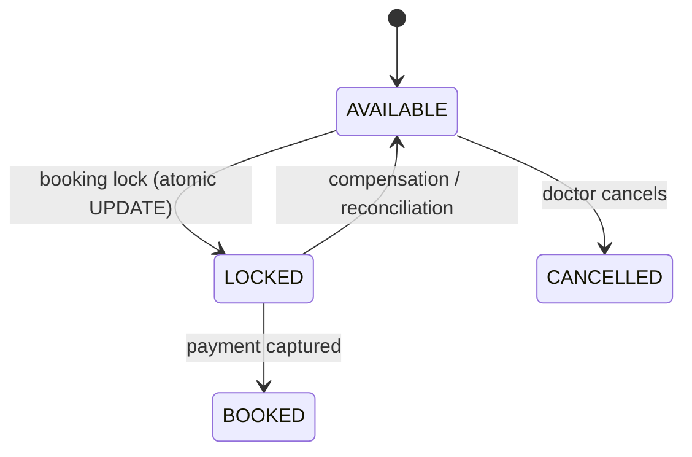

# 🗄️ Database Architecture

<!-- docs-nav -->

<a href="README.md">Hub</a> · <a href="Architecture-overview.md">Overview</a> · <a href="ARCHITECTURE.md">Deep dive</a> · <a href="backend-architecture.md">Backend</a> · <a href="frontend-architecture.md">Frontend</a> · <b>Database</b> · <a href="authentication-architecture.md">Auth</a> · <a href="api-endpoints.md">API</a> · <a href="SECURITY.md">Security</a> · <a href="tech-stack.md">Stack</a> · <a href="configuration-and-environment.md">Config</a> · <a href="setup.md">Setup</a> · <a href="observability.md">Observability</a> · <a href="testing.md">Testing</a> · <a href="troubleshooting.md">Troubleshooting</a>

> **PostgreSQL** is the system of record. **Redis** supports caching and streams. Redis complements Postgres; it never replaces it.

## 🧭 1. Where data lives

## 🧱 2. Schema ownership

> [!IMPORTANT]
> The API module owns the schema and persistence model and is the single source of truth for schema evolution. Workers may use raw SQL for operational flows but own no JPA entities or repositories.

## 🗂️ 3. Entity groups

## 🧬 4. Full ER diagram

> Constraints worth knowing: `availability_slots` is unique on `(doctor_id, start_at, end_at)`; `idempotency_keys` is unique on `(user_id, method, path, body_hash)`.

## 🔁 5. Slot lifecycle

## ⚡ 6. Redis usage

| Use | Description |
| --- | --- |
| 🧠 Cache | Per-cache TTLs (users, doctors, availability, consultations, analytics) |
| 📡 Streams | Event-based processing, e.g. audit stream |
| 🔔 Notifications | Notification handling |
| 🧰 Worker state | Supporting background worker state |

## 🏭 7. Operational considerations

The local environment uses a simplified data model. Production is designed for backup, retention and scaling (partitioning plan and RPO/RTO targets in [ARCHITECTURE.md](ARCHITECTURE.md#8--partitioning-future-ops-step)).

<!-- docs-footer -->
---

⬅️ <a href="frontend-architecture.md">Frontend</a> · 🏠 <a href="README.md">Docs hub</a> · <a href="authentication-architecture.md">Auth</a> ➡️
