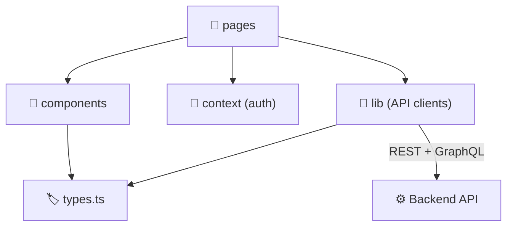
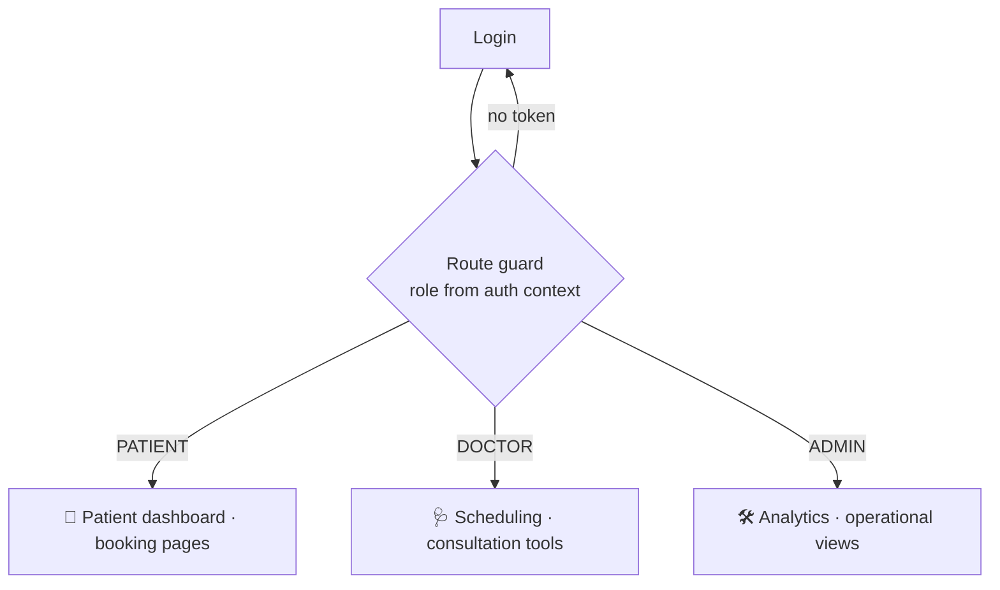
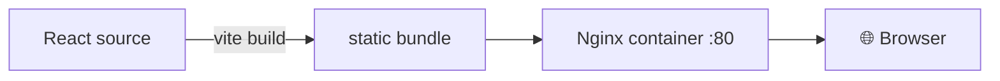

# 🖥️ Frontend Architecture

> A separate **React + TypeScript** app that serves the telemedicine UI, intentionally isolated from backend runtime composition.

## 🧰 1. Stack


CSS-based styling · REST + GraphQL client layers.

## 🎯 2. Responsibilities

| Area | Features |
| --- | --- |
| 🔑 Access | Login, registration, role-based routes |
| 🔎 Discovery | Doctor search and browsing |
| 📅 Booking | Booking flow, consultation status |
| 🩺 Doctor tools | Scheduling and administration |
| 📊 Admin | Analytics dashboards |

## 🌳 3. Application structure

```text
frontend/
└── src/
    ├── pages/        📄 route-driven screens
    ├── components/   🧩 reusable UI + app shell
    ├── context/      🧠 shared state + auth context
    ├── lib/          🔌 REST/GraphQL clients, helpers
    └── types.ts      🏷️ common TypeScript models
```



## 🚦 4. Auth and routing model



> [!NOTE]
> Route guards are a UX convenience. Real enforcement always happens on the backend (see [authentication-architecture.md](authentication-architecture.md)).

## 🔌 5. API integration

| Style | Used for |
| --- | --- |
| REST | Transactional operations |
| GraphQL | Read-focused interactions |

The dev server proxies API calls, so local development needs no direct CORS handling.

## 🐳 6. Runtime



## 💡 7. Design intent

Small, focused modules · clean split between UI and client access logic · role-based routes · simple backend integration points.