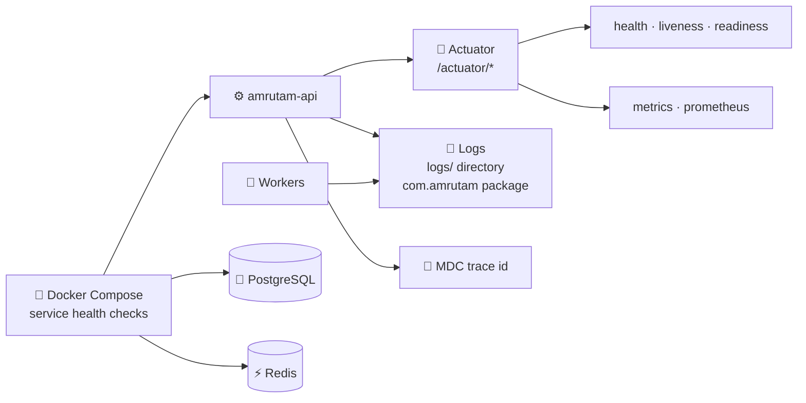

# 🔭 Observability and Operations

<!-- docs-nav -->

<a href="README.md">Hub</a> · <a href="Architecture-overview.md">Overview</a> · <a href="ARCHITECTURE.md">Deep dive</a> · <a href="backend-architecture.md">Backend</a> · <a href="frontend-architecture.md">Frontend</a> · <a href="database-architecture.md">Database</a> · <a href="authentication-architecture.md">Auth</a> · <a href="api-endpoints.md">API</a> · <a href="SECURITY.md">Security</a> · <a href="tech-stack.md">Stack</a> · <a href="configuration-and-environment.md">Config</a> · <a href="setup.md">Setup</a> · <b>Observability</b> · <a href="testing.md">Testing</a> · <a href="troubleshooting.md">Troubleshooting</a>

> The project exposes enough operational signals to support local diagnosis and basic readiness checks; production hardening and full monitoring are still follow-up work.

## 🧭 Signals at a glance

## 🩻 1. Health and metrics endpoints

The API exposes Spring Boot Actuator under the base path `/actuator`, configured in [application.yml](../backend/amrutam-api/src/main/resources/application.yml).

| Endpoint | Purpose |
| --- | --- |
| `/actuator/health` | Overall health (primary readiness check) |
| `/actuator/health/liveness` | Is the process alive |
| `/actuator/health/readiness` | Is the app ready to take traffic |
| `/actuator/prometheus` | Metrics in Prometheus format |
| `/actuator/metrics` | Metric browser |

## 📝 2. Log and trace signals

| Signal | Detail |
| --- | --- |
| File logging | Written under `logs/` |
| Application logs | Output through the `com.amrutam` package |
| Trace propagation | MDC trace-id patterns, as described in the architecture notes |

## ✅ 3. What a healthy stack looks like

| Check | Expected |
| --- | --- |
| 🐘 PostgreSQL | Ready |
| ⚡ Redis | Ping succeeds |
| ⚙️ Application health | `UP` |
| 🔄 Workers | No critical startup errors |

The platform relies on PostgreSQL for primary persistence, Redis for caching and messaging/worker coordination, and Docker Compose service health checks for startup ordering.

## 🛠️ 4. Operational guidance

1. Monitor the API health endpoint as the primary readiness check.
2. Inspect Docker service logs if the API or workers fail to start.
3. Review the log directory for recent runtime issues.
4. For production, extend monitoring with centralized log aggregation, alerting and metric dashboards.

## 🔗 Related docs

[backend-architecture.md](backend-architecture.md) · [SECURITY.md](SECURITY.md) · [testing.md](testing.md) · [troubleshooting.md](troubleshooting.md)

<!-- docs-footer -->
---

⬅️ <a href="setup.md">Setup</a> · 🏠 <a href="README.md">Docs hub</a> · <a href="testing.md">Testing</a> ➡️
