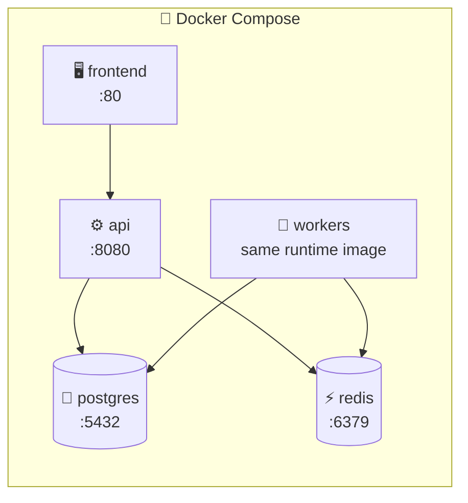

# 🚀 Setup and Startup

<!-- docs-nav -->
<p align="center"><sub><a href="README.md">Hub</a> · <a href="Architecture-overview.md">Overview</a> · <a href="ARCHITECTURE.md">Deep dive</a> · <a href="backend-architecture.md">Backend</a> · <a href="frontend-architecture.md">Frontend</a> · <a href="database-architecture.md">Database</a> · <a href="authentication-architecture.md">Auth</a> · <a href="api-endpoints.md">API</a> · <a href="SECURITY.md">Security</a> · <a href="tech-stack.md">Stack</a> · <a href="configuration-and-environment.md">Config</a> · <b>Setup</b> · <a href="observability.md">Observability</a> · <a href="testing.md">Testing</a> · <a href="troubleshooting.md">Troubleshooting</a></sub></p>


> Runs entirely on **Docker Compose**. No local PostgreSQL or Redis installation needed.

## ⚡ Quick start

```bash
# macOS / Linux / Git Bash
./start.sh
```

```powershell
# Windows PowerShell
./start.ps1
```

## 🧱 What gets started



| Service | Port | Notes |
| --- | --- | --- |
| 🐘 PostgreSQL | 5432 | Schema created by the API on startup |
| ⚡ Redis | 6379 | Cache and streams |
| ⚙️ API | 8080 | REST + GraphQL |
| 🔄 Workers | n/a | Same runtime image as the API |
| 🖥️ Frontend | 80 | Nginx-served React bundle |

## 🔗 Useful URLs

| What | URL |
| --- | --- |
| Frontend | http://localhost |
| API | http://localhost:8080 |
| Swagger UI | http://localhost:8080/swagger-ui.html |
| Health | http://localhost:8080/actuator/health |

## 🐳 Docker-first notes

> [!IMPORTANT]
> Start the backend through the compose stack, not by running Postgres/Redis on the host. Runtime config uses container service names (`postgres`, `redis`) and binds to those internal addresses automatically.

## ✅ Verify it works

```bash
curl http://localhost:8080/actuator/health
# expect: {"status":"UP"}
```

## 📚 Next

[README](README.md) · [ARCHITECTURE](ARCHITECTURE.md) · [SECURITY](SECURITY.md)

<!-- docs-footer -->
---

<p align="center">⬅️ <a href="configuration-and-environment.md">Configuration</a> · 🏠 <a href="README.md">Docs hub</a> · <a href="observability.md">Observability</a> ➡️</p>