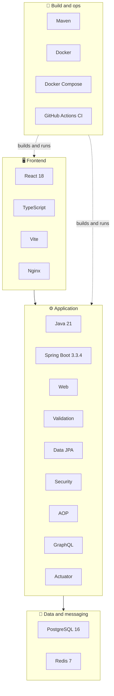

# 🧰 Tech Stack

<!-- docs-nav -->

<a href="README.md">Hub</a> · <a href="Architecture-overview.md">Overview</a> · <a href="ARCHITECTURE.md">Deep dive</a> · <a href="backend-architecture.md">Backend</a> · <a href="frontend-architecture.md">Frontend</a> · <a href="database-architecture.md">Database</a> · <a href="authentication-architecture.md">Auth</a> · <a href="api-endpoints.md">API</a> · <a href="SECURITY.md">Security</a> · <b>Stack</b> · <a href="configuration-and-environment.md">Config</a> · <a href="setup.md">Setup</a> · <a href="observability.md">Observability</a> · <a href="testing.md">Testing</a> · <a href="troubleshooting.md">Troubleshooting</a>

## 🗺️ Layered view

## 📋 Details

| Layer | Technology | Why it is here |
| --- | --- | --- |
| Language | Java 21 | Modern LTS runtime |
| Framework | Spring Boot 3.3.4 | Practical application framework for this codebase |
| Web | Spring Web | REST controllers |
| Validation | Spring Validation | Input checks |
| Persistence | Spring Data JPA | Entities and repositories (API only) |
| Security | Spring Security | JWT filter, method security |
| Cross-cutting | Spring AOP | Auditing and similar concerns |
| Query API | Spring GraphQL | Schema-driven reads |
| Monitoring | Spring Actuator | Health and metrics |
| Database | PostgreSQL 16 | System of record |
| Cache / streams | Redis 7 | Caching, audit stream, notifications |
| Frontend | React 18 · TypeScript · Vite | Typed, fast UI |
| Serving | Nginx | Static bundle in Docker |
| Build | Maven | Multi-module build |
| Containers | Docker · Docker Compose | One-command local stack |
| CI | GitHub Actions | Build, test, OWASP dependency-check |

## 🛠️ Development and operations

✅ structured logging · ✅ health checks · ✅ environment-based configuration · ✅ modular backend for service isolation

## 🎯 Design intent

Clean separation between the **API**, **background processing**, **shared infrastructure** and the **frontend UI**, while keeping local execution simple and containerized.

<!-- docs-footer -->
---

⬅️ <a href="SECURITY.md">Security</a> · 🏠 <a href="README.md">Docs hub</a> · <a href="configuration-and-environment.md">Configuration</a> ➡️
