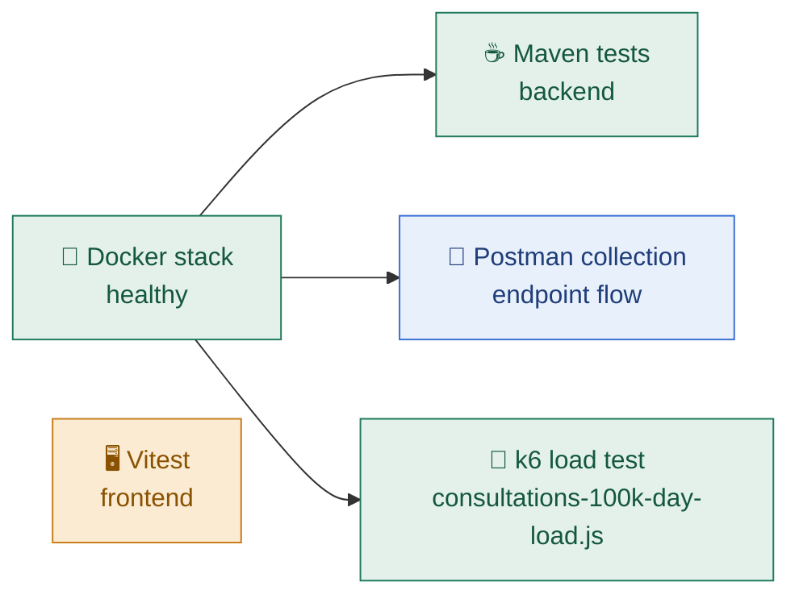

# 🧪 Testing and Verification

<!-- docs-nav -->
<p align="center"><sub><a href="README.md">Hub</a> · <a href="Architecture-overview.md">Overview</a> · <a href="ARCHITECTURE.md">Deep dive</a> · <a href="backend-architecture.md">Backend</a> · <a href="frontend-architecture.md">Frontend</a> · <a href="database-architecture.md">Database</a> · <a href="authentication-architecture.md">Auth</a> · <a href="api-endpoints.md">API</a> · <a href="SECURITY.md">Security</a> · <a href="tech-stack.md">Stack</a> · <a href="configuration-and-environment.md">Config</a> · <a href="setup.md">Setup</a> · <a href="observability.md">Observability</a> · <b>Testing</b> · <a href="troubleshooting.md">Troubleshooting</a></sub></p>


> Every command below was executed and its outcome recorded. Items that were not run, or whose result was not recorded, are marked as open rather than assumed.

## 📊 Status dashboard

| Check | Command or artifact | Recorded result | Status |
| --- | --- | --- | --- |
| 🐳 Docker stack health | `docker compose ps` + `/actuator/health` | 3 containers healthy, health `UP` | ✅ Verified |
| ☕ Backend tests (Maven) | `cd backend; mvn -q test` | `EXIT_CODE=0` | ✅ Verified |
| 🚀 Load test (k6) | `docker run … grafana/k6 run …` | 61 iterations in 30 s, 0 failed requests | ✅ Verified |
| 🔌 API endpoints (Postman) | `amrutam-postman-collection.json` | Evidence in [API_TESTING_REPORT.md](API_TESTING_REPORT.md) | ℹ️ Evidence kept |
| 🖥️ Frontend tests (Vitest) | `npm run test:run` | No result recorded | ⏳ Open |
| 📸 Frontend page screenshots | `docs/images/frontend/` | Not captured in this environment | ⏳ Open |

## 🧭 Test layers



## 🐳 1. Docker stack health

**Command executed**

```powershell
docker compose ps; Invoke-RestMethod -Uri 'http://localhost:8080/actuator/health' | ConvertTo-Json -Depth 6
```

**Verified result**

```text
NAME                 IMAGE                COMMAND                  SERVICE    CREATED       STATUS                 PORTS
amrutam-api-1        amrutam:local        "/app/entrypoint.sh"     api        2 hours ago   Up 2 hours (healthy)   0.0.0.0:8080->8080/tcp, [::]:8080->8080/tcp
amrutam-postgres-1   postgres:16-alpine   "docker-entrypoint.s…"   postgres   2 hours ago   Up 2 hours (healthy)   0.0.0.0:5432->5432/tcp, [::]:5432->5432/tcp
amrutam-redis-1      redis:7-alpine       "docker-entrypoint.s…"   redis      2 hours ago   Up 2 hours (healthy)   0.0.0.0:6379->6379/tcp, [::]:6379->6379/tcp
```

**Health payload excerpt**

```json
{
  "status": "UP",
  "components": {
    "db": { "status": "UP" },
    "redis": { "status": "UP" }
  }
}
```

> [!NOTE]
> Evidence: actual runtime output from the live stack. A terminal-style rendering of the full output is Figure 1 in [API_TESTING_REPORT.md](API_TESTING_REPORT.md).

## ☕ 2. Maven test run

**Command executed**

```powershell
cd backend; mvn -q test
```

**Verified outcome from the fresh run**

```text
EXIT_CODE=0
```

> [!IMPORTANT]
> Current status: the backend test suite passes after fixing the shared security wiring, so the worker context no longer tries to create an `AuthenticationManager` without an `AuthenticationProvider` bean.

## 🚀 3. k6 load test

**Command executed**

```powershell
docker run --rm --add-host=host.docker.internal:host-gateway -e BASE_URL=http://host.docker.internal:8080 -e TARGET_PER_DAY=100000 -e TEST_DURATION=30s -v "${PWD}:/scripts" grafana/k6 run /scripts/scripts/consultations-100k-day-load.js
```

| Parameter | Value |
| --- | --- |
| `BASE_URL` | `http://host.docker.internal:8080` |
| `TARGET_PER_DAY` | `100000` |
| `TEST_DURATION` | `30s` |
| Script | `scripts/consultations-100k-day-load.js` |

**Verified outcome from the command result**

| Metric | Measured |
| --- | --- |
| Successful iterations | **61 in 30 s** |
| Failed requests | **0** |
| Booking success | **100%** |
| Login success | **100%** |
| p95 latency | **≈ 206 ms** |

```text
Required target    100,000 consultations / day   ≈ 1.16 per second (calculated: 100,000 ÷ 86,400)
Measured window    61 iterations in 30 s         ≈ 2.03 per second, 0 failed requests
```

This exceeds the requested 100,000 consultations/day equivalent target in the measured window. See [API_TESTING_REPORT.md](API_TESTING_REPORT.md) for the full requirement-versus-measured comparison and its caveats (30-second window, single local instance).

## 🔌 4. Postman and API evidence

The repository contains the live Postman collection and the testing report:

| Artifact | Purpose |
| --- | --- |
| `amrutam-postman-collection.json` | The Postman collection used for the endpoint run |
| [`docs/API_TESTING_REPORT.md`](API_TESTING_REPORT.md) | Report with screenshots and per-request results |

These are treated as evidence artifacts, and the report is kept honest: it does not claim more than the run actually showed.

## 💻 5. How to run tests locally

| What | Command | Folder |
| --- | --- | --- |
| Backend tests | `mvn test` | `backend/` |
| Frontend tests | `npm install` then `npm run test:run` | `frontend/` |
| Start the stack (macOS / Linux / Git Bash) | `./start.sh` | repository root |
| Start the stack (Windows PowerShell) | `./start.ps1` | repository root |

```bash
# Backend (Maven)
cd backend
mvn test
```

```bash
# Frontend (Vitest)
cd frontend
npm install
npm run test:run
```

```bash
# Docker Compose lifecycle
./start.sh
```

```powershell
# or, on Windows
./start.ps1
```

## 🔎 6. Open items

| # | Item | Why it is open |
| --- | --- | --- |
| 1 | Browser screenshots for every frontend page | Not executed in this environment, so explicitly unverified |
| 2 | Frontend Vitest result | The command is documented, but no run result is recorded here |
| 3 | Worker test status | The verified status is that the backend Maven suite passes after the shared security wiring fix; no additional worker test failures are being claimed |

<!-- docs-footer -->
---

<p align="center">⬅️ <a href="observability.md">Observability</a> · 🏠 <a href="README.md">Docs hub</a> · <a href="API_TESTING_REPORT.md">API testing report</a> ➡️</p>