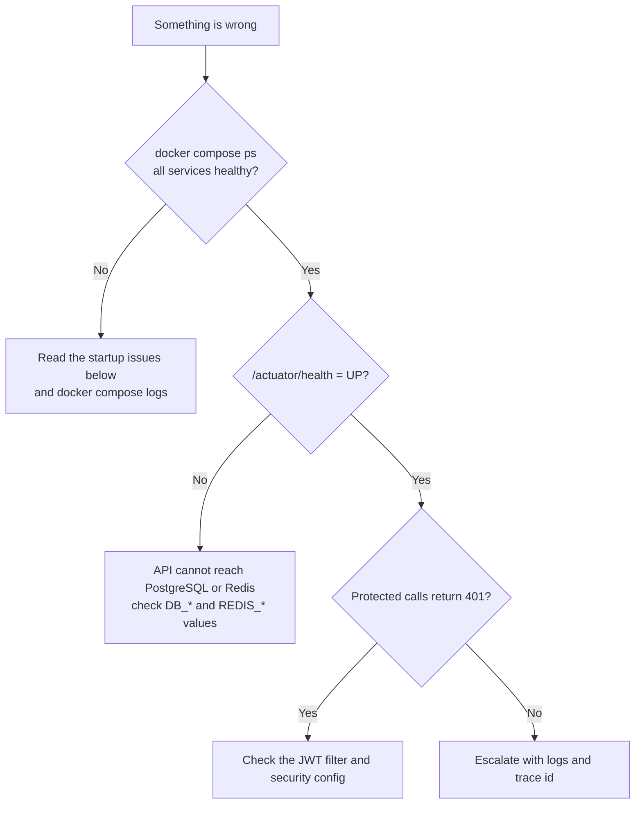

# 🩺 Troubleshooting and FAQ

<!-- docs-nav -->

<a href="README.md">Hub</a> · <a href="Architecture-overview.md">Overview</a> · <a href="ARCHITECTURE.md">Deep dive</a> · <a href="backend-architecture.md">Backend</a> · <a href="frontend-architecture.md">Frontend</a> · <a href="database-architecture.md">Database</a> · <a href="authentication-architecture.md">Auth</a> · <a href="api-endpoints.md">API</a> · <a href="SECURITY.md">Security</a> · <a href="tech-stack.md">Stack</a> · <a href="configuration-and-environment.md">Config</a> · <a href="setup.md">Setup</a> · <a href="observability.md">Observability</a> · <a href="testing.md">Testing</a> · <b>Troubleshooting</b>

> Find your symptom, run the checks, and escalate only if they do not help.

## 🧭 Where to start

## 🐳 Common startup issues

### 1. Docker startup fails with script errors

| | |
| --- | --- |
| 🔴 **Symptoms** | `entrypoint.sh` fails to run · the container exits immediately · the Linux shell reports line-ending or permission issues |
| 🔎 **Checks** | Ensure the repository was checked out without Windows CRLF conversion · verify the script is executable in the container context · use the repo-provided startup scripts rather than running raw commands manually |

### 2. API does not connect to PostgreSQL

| | |
| --- | --- |
| 🔴 **Symptoms** | The application starts but fails database access · the health endpoint stays unhealthy · errors mention database connection failures |
| 🔎 **Checks** | Confirm `DB_HOST`, `DB_PORT`, `DB_NAME` and `DB_USER` match the compose service values · ensure the `postgres` service is healthy before the API starts · confirm the JDBC URL is reachable from the container network |

### 3. JWT login fails or returns 401

| | |
| --- | --- |
| 🔴 **Symptoms** | The login request is accepted but protected endpoints fail · the custom auth flow is overridden by default security behaviour |
| 🔎 **Checks** | Verify the security configuration does not re-enable form or HTTP Basic login unexpectedly · confirm the shared security config is imported into the API security chain · confirm the JWT filter runs before authentication decisions for protected routes |

## ⌨️ Validation commands

| Purpose | Command |
| --- | --- |
| Health | `curl http://localhost:8080/actuator/health` |
| Docker status | `docker compose ps` |
| API logs | `docker compose logs --tail=200 api` |

## 🚨 When to escalate

Open an issue or request engineering support when:

- [ ] the API remains unhealthy after a clean stack restart
- [ ] database or Redis data loss is observed
- [ ] worker jobs remain stuck for longer than the configured processing window
- [ ] auth failures persist across a clean environment rebuild

## 🔗 Related docs

[setup.md](setup.md) · [SECURITY.md](SECURITY.md) · [configuration-and-environment.md](configuration-and-environment.md) · [observability.md](observability.md)

<!-- docs-footer -->
---

⬅️ <a href="API_TESTING_REPORT.md">API testing report</a> · 🏠 <a href="README.md">Docs hub</a> · <a href="CHANGELOG.md">Changelog</a> ➡️
