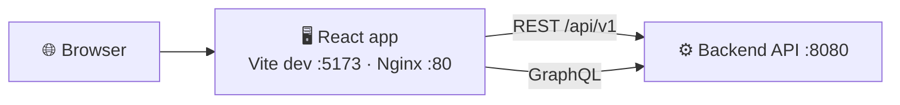

<div align="center">

# 🖥️ Amrutam Frontend

**The Vite + React + TypeScript app for the Amrutam telemedicine platform.**


<a href="#-local-development">Development</a> ·
<a href="#-project-structure">Structure</a> ·
<a href="#-pages">Pages</a> ·
<a href="#-documentation">Documentation</a>

</div>

---

## 🎯 Overview

The frontend is intentionally separated from the backend runtime and communicates with the API over **REST** and **GraphQL**.



> [!NOTE]
> The runtime stack is Docker-first: start the backend through Docker Compose from the repository root (`./start.sh` or `./start.ps1`). Frontend setup is documented in the shared project docs.

## 🚀 Local development

From this directory:

```bash
npm install
npm run dev
```

The app runs on **http://localhost:5173** by default. The dev server proxies API calls, so local development needs no direct CORS handling.

### Scripts

| Script | What it does |
| --- | --- |
| `npm run dev` | Run the Vite dev server |
| `npm run build` | Build the production bundle |
| `npm run preview` | Preview the production build |
| `npm test` | Run the frontend test suite |
| `npm run test:run` | Run the tests once, as used in the [contributing guide](../docs/CONTRIBUTING.md) and the [testing doc](../docs/testing.md) |

## 🌳 Project structure

```text
frontend/
├── Dockerfile                     image build for the Nginx runtime
├── nginx.conf                     Nginx configuration
├── package.json
└── src/
    ├── main.tsx                   🚦 route definitions
    ├── types.ts                   🏷️ shared TypeScript models
    ├── pages/                     📄 route-driven screens (+ __tests__/)
    │   ├── LoginPage.tsx
    │   ├── RegisterPage.tsx
    │   ├── DoctorsPage.tsx
    │   ├── PatientDashboard.tsx
    │   ├── DoctorDashboard.tsx
    │   └── AdminDashboard.tsx
    ├── components/                🧩 reusable UI and app shell
    │   ├── ProtectedRoute.tsx     route guard (UX convenience)
    │   ├── BookingFlow.tsx
    │   ├── SlotsManager.tsx
    │   ├── DailyConsultationsChart.tsx
    │   └── ui                     shared UI helpers
    ├── context/
    │   └── AuthContext.tsx        🧠 auth state: user, token, MFA step
    └── lib/
        ├── api                    🔌 REST client and ApiError
        └── graphql                🔮 GraphQL client
```

## 📄 Pages

| Page | Purpose |
| --- | --- |
| `LoginPage` | Sign in, with an MFA code step when the account requires it |
| `RegisterPage` | Create a patient account |
| `DoctorsPage` | Search and browse doctors |
| `PatientDashboard` | Book a doctor, view consultations, cancel, read prescriptions |
| `DoctorDashboard` | Manage availability slots and complete consultations |
| `AdminDashboard` | Daily consultations chart, revenue summary, doctor utilization, system health |

> [!IMPORTANT]
> Route guards are a UX convenience. Real authorization is always enforced by the backend. See [authentication-architecture.md](../docs/authentication-architecture.md).

## 📚 Documentation

For the full frontend design and project context:

| Document | What you will learn |
| --- | --- |
| [frontend-architecture.md](../docs/frontend-architecture.md) | Frontend structure, routing and auth model |
| [Architecture-overview.md](../docs/Architecture-overview.md) | The big picture across frontend, backend and data |
| [api-endpoints.md](../docs/api-endpoints.md) | The API this app calls |
| [setup.md](../docs/setup.md) | Starting the whole stack |

This README is intentionally concise to avoid duplicating the project-level documentation.

---

<div align="center">

🌿 [Project README](../README.md) · [Documentation hub](../docs/README.md)

</div>